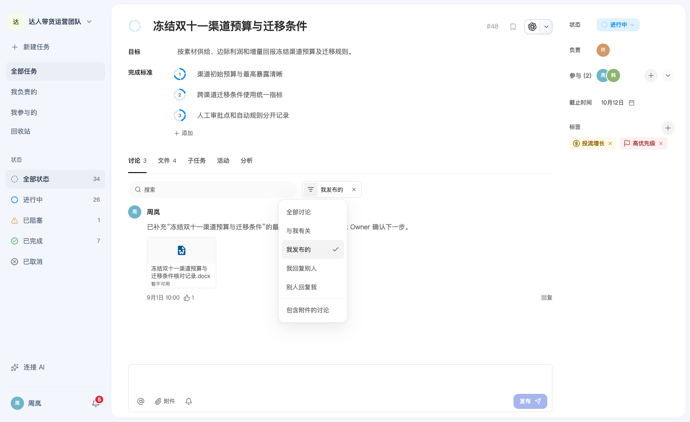
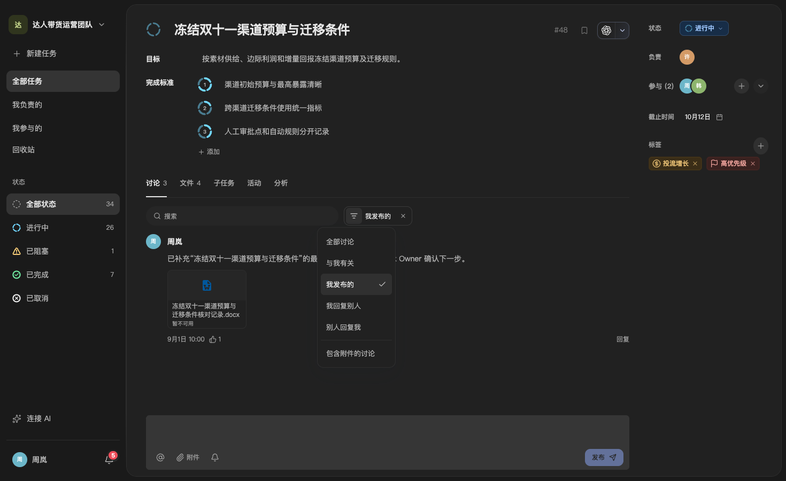
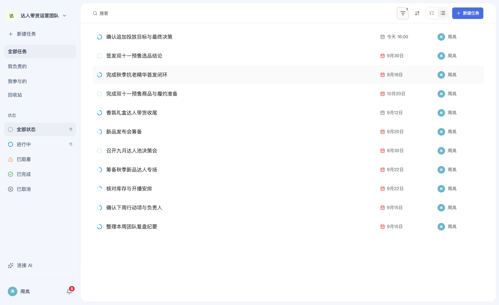

# 讨论时间、搜索筛选与列表筛选底色交付依据

交付范围为三项：任务／文件讨论的时间切换；任务讨论搜索与关系／附件筛选，以及讨论／文件搜索框统一；任务列表筛选选中浅底。

## 正式项目来源

2026-11-20核对`nocoly/taskdoor`最新dev `ee8b46f0c6705ab92695826432f0a548b674be13`：

- `apps/web/src/features/tasks/components/TaskDiscussion.tsx`没有讨论查询状态，阅读回执读取完整消息集合。
- 两种讨论消息组件仍直接渲染`<time>`，没有点击切换。
- `task-workspace-list.css`高级筛选按钮和其数量徽标最终覆盖仍使用`--ad-surface-subtle`；正式接入需同时调整这两处覆盖。

## PM Demo实现

基于最新main `8c8d4c49d70245da9916c165ab746432b7a7e8e5`独立提取，保留现有置顶、点赞、收藏、团队标签ID、文件排序和上传人等实现。

- 时间：`DiscussionTimestamp.tsx`及两种消息组件。
- 搜索筛选：`DiscussionFilter.tsx`、`discussion-filter.ts`、`TaskDiscussion.tsx`；作者名称复用人员目录。筛选先覆盖全部消息，再保留置顶分区与普通倒序；不改写置顶关系或点赞集合。
- 样式：`task-pane-toolbar.css`、`task-filter-shared.css`、讨论与文件相关样式；任务列表选中按钮和徽标使用`--ad-surface-quiet`。

## 验证

41项定向测试、应用TypeScript检查和结构检查通过。测试同时覆盖范围与附件交集、直接回复与有效提及、草稿／定位、时间切换、文件浏览，以及现有置顶／点赞／收藏；既有测试的旧删除／回复class定位已对齐现行组件。Vite前端生产打包通过。

交付分支预览`http://127.0.0.1:5188/`，1470×900、390×844、简体中文、浅深主题：两页签搜索框位置／宽高／背景／圆角一致；菜单仅图标区高亮、无清除全部；分别清除保留另一类条件、切页签保持、Escape回焦、时间独立切换通过。当前账号具备置顶入口时，置顶消息筛选隐藏再恢复、取消置顶后原顺序均通过；点赞及收藏入口保留，无页面运行错误。列表选中按钮及数量徽标实测浅#fafafa／深#262626，手机点击区≥44px。

未运行全量测试或双重审查。PRD图使用主工作区5173的现行截图；下图单独记录交付分支5188的实际检查，不冒充主工作区截图。

