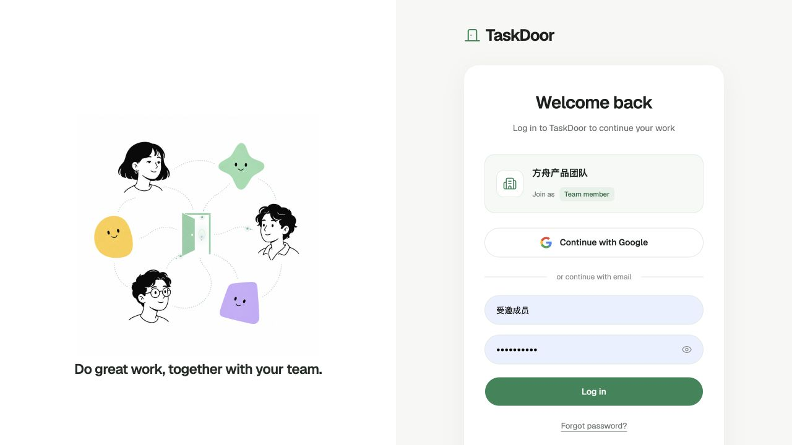
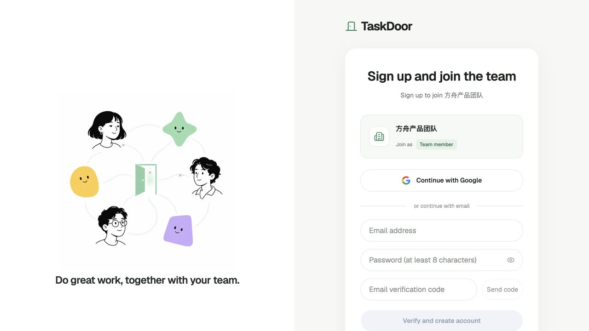
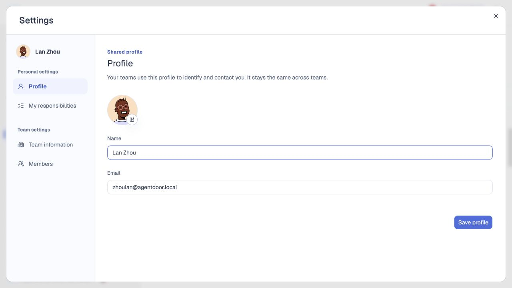

# 产品界面预览

## 1. 目的

按场景浏览产品界面与操作流程。

## 2. 范围和边界

涵盖账号、团队、任务创建、协作与工具连接的主要界面。

## 3. 详细功能设计

### 团队与账号

*FIG-PREVIEW-050 · 受邀登录：核对团队与加入身份，登录后继续加入。*

*FIG-PREVIEW-051 · 受邀注册：保留团队与身份，已有账号可切换登录。*

*FIG-PREVIEW-020 · 个人信息 Profile：头像、姓名与邮箱。*

### 创建规划

### 任务协作

### 连接 AI

## 4. 功能验收标准

按分类切换缩略图，点击缩略图、顶部前后按钮或大图左右两侧的箭头查看完整大图，支持左右方向键。仅显示必要导航与当前图片说明，不展开长篇正文；打印时展开全部截图。
