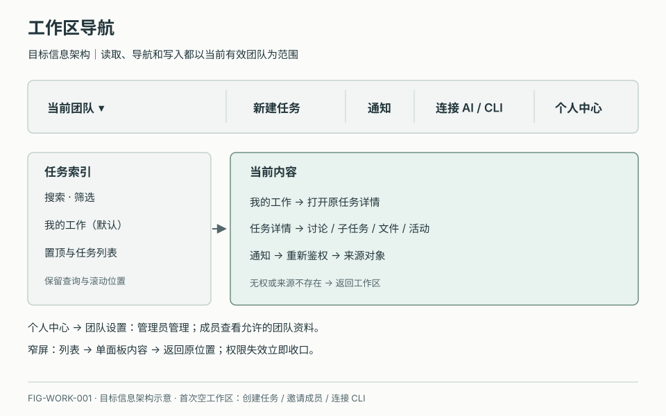

# 工作区与导航

## 1. 目的

提供稳定的团队、任务与个人设置入口。

## 2. 范围和边界

覆盖团队切换、任务入口及个人与团队设置。

## 3. 详细功能设计

### 3.1 进入与切换

已完成首次设置且有团队的用户登录后直接查看任务，顶栏可切换已有团队；新用户设置及已有用户无团队的处理见[团队管理](03-team-onboarding.md)。团队切换菜单只展示团队图标、名称和当前选中状态，不展示用户在各团队中的身份；身份在团队设置和成员管理中查看。

团队切换菜单中每个团队只出现一次，当前团队通过选中状态标识。

全局顶部栏右侧提供 **新建任务**，进入当前团队的任务创建对话，流程见[任务创建](07-task-creation.md)。入口在列表与详情中均可使用；窄屏保留图标按钮和完整的无障碍名称。空工作区同时提供就地创建入口，两者进入同一流程。

桌面可收起任务列表以专注当前详情；收起态通过侧栏图标重新展开，完整入口、任务上下文与窄屏切换规则见[任务列表](06-task-list.md) 3.4。收起任务列表后，顶栏的团队与全局操作入口保持可用。

### 3.2 个人与团队设置

- **个人设置**：个人信息、我的责任、我的团队与访问令牌；访问令牌见[Agent 与 CLI 连接](05-cli-connection.md) 3.3；我的团队的列表与已删除团队恢复见[删除与数据保留](13-deletion-recovery-retention.md) 3.4；只读邮箱及维护规则见[账号与个人资料](02-account-identity.md) 3.6。
- **团队设置**：团队信息、成员管理、团队时区及拥有者专属的所有权转让与删除入口；拥有者和管理员另有团队任务与行为日志，见[团队管理](03-team-onboarding.md) 3.6；日期规则见[语言、翻译与时区](02-internationalization.md)。

*FIG-WORK-001 · 工作区导航设计。*

团队切换菜单底部固定显示“创建团队”，团队列表独立滚动。创建流程和数量限制见[团队管理](03-team-onboarding.md)。

## 4. 功能验收标准

- **团队切换**：不混入上一团队内容；菜单不显示管理员／成员身份，当前团队仍有明确选中状态。
- **空工作区**：提供明确的新建入口。
- **新建任务**：从列表或详情的顶栏入口打开当前团队创建对话；窄屏图标按钮仍可通过触控及键盘操作，进入对话前不产生任务。
