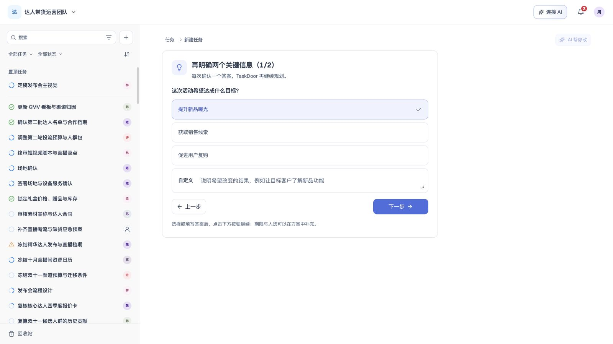
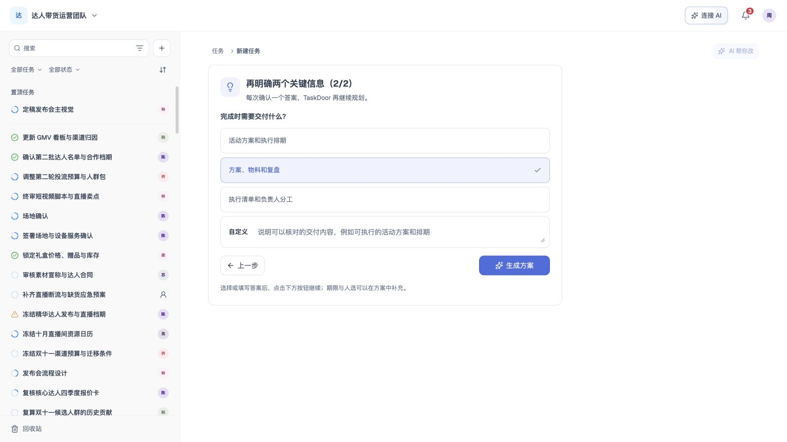
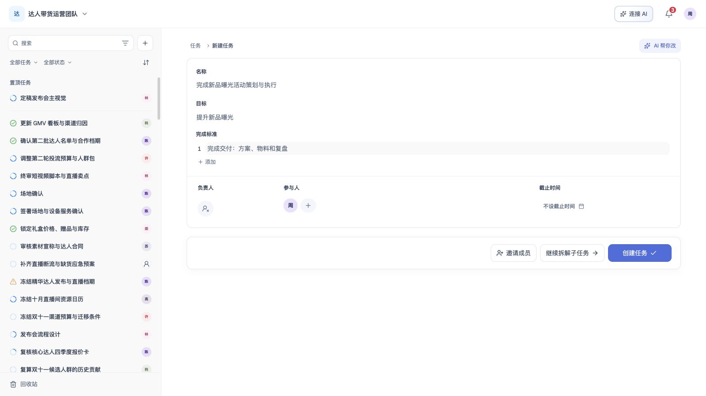

# 任务创建

## 1. 目的

把用户的需求整理为目标明确、可分工的任务方案，经用户确认后创建。

## 2. 范围和边界

- **对话创建**：所有界面新建入口进入同一对话流程，支持需求补问、已有任务识别、按需拆解、人员推荐与方案编辑，层级遵循团队配额。

## 3. 详细功能设计

### 3.1 整体流程

用户输入想法 → 补问或确认已有任务关系 → 审阅主任务 → 直接创建，或继续拆解并审阅子任务 → 统一确认创建。

### 3.2 分步处理

| 规划步骤 | 系统处理 | 用户操作与结果 |
| --- | --- | --- |
| **1. 分析任务** | 提取目标、交付内容与限制。信息不足时补问；发现疑似重复任务或可能的父任务时，展示候选及原因。 | 补充关键信息；对候选任务选择查看已有任务、继续独立规划或作为子任务继续。没有对应分支时直接进入下一步。 |
| **2. 目标与计划** | 先生成主任务的目标、完成标准、人员与截止日期。 | 审阅主任务；需要分工时主动继续拆解，整条路径不超过团队层级配额。 |
| **3. 成员推荐** | 按每个任务的目标、完成标准与所需工作匹配团队成员责任域，推荐负责人和参与者。 | 调整人选；未匹配时保持未分配，也可邀请团队外人员。详细规则见[成员、邀请与任务分工](09-member-collaboration.md)。 |
| **4. 动态规划** | 整理日期依据，标出需要用户核对的安排，汇总完整任务方案。 | 核对日期及拆解后的子任务安排；通过 AI 帮你改提出调整，审阅建议后应用，也可人工编辑或重新生成。 |

**审阅与创建**

四个规划步骤完成后默认先进入主任务审阅，不因任务复杂或标准数量多而强制拆解。用户可直接创建主任务，或明确要求继续拆解；已经明确要求拆解时按该意图生成子任务，不重复询问。拆解时展示处理中状态，按当前主任务的目标与完成标准整理子任务方案，结果返回后再审阅。在同一对话中核对子任务后统一创建。拆解过程复用创建时的思考步骤区域，全宽显示阶段进展，支持停止并保留主任务；不在底部操作栏单独显示等待文案。已创建任务可从概览新增子任务，经审阅后创建。用户可编辑任务结构、字段与人员，也可使用 AI 帮你改生成调整建议，审阅后应用到当前方案；确认后，系统校验权限、层级、人员和日期，并统一创建整份方案。创建失败时保留当前方案，修正后重试。

**常见场景**

| 输入情形 | 处理方式 |
| --- | --- |
| “整理本次会议纪要” | 直接生成单任务。 |
| “做一次活动”但目标、交付不清 | 补问活动目的与交付内容后规划。 |
| 项目包含商务、内容、发布等工作 | 先审阅主任务，用户选择继续拆解时生成可分工的子任务。 |
| 内容制作还包含脚本、具体交付项 | 继续拆解，整条路径不超过团队层级配额。 |
| 已有任务可能覆盖同一交付 | 提示疑似重复，由用户选择查看已有任务或继续新建，不自动合并。 |
| 需求可能属于已有项目 | 用户确认父任务后，作为其子任务规划。 |
| 没有匹配负责人 | 保持未分配，允许人工选择或邀请，不阻止创建。 |

**界面案例：补充活动信息后审阅方案**

*FIG-CREATE-005 · 确认活动目标，选择“提升新品曝光”后继续。*

*FIG-CREATE-006 · 确认交付内容，选择“方案、物料和复盘”后生成方案。*

*FIG-CREATE-007 · 审阅活动方案，核对目标、完成标准与人员后确认创建。*

### 3.3 生成的任务结构

方案包含一个或多个任务及其父子归属。**每个任务都保存自己的目标与完成标准**。创建子任务时可将父任务目标作为初始内容，之后独立编辑；不要求父子目标文字不同，修改父目标不自动覆盖子目标。

| 内容 | 说明与编辑规则 |
| --- | --- |
| **任务名称** | 简短说明要做什么，可编辑。 |
| **目标（目的）** | 说明为什么做、希望达成什么结果，可编辑。 |
| **任务完成标准** | 有序列出可核对的交付或结果，支持新增、修改和删除，不提供拖动或上移／下移调序入口。 |
| **人员** | 一名负责人及多名参与者；负责人可为空，最终以用户选择为准。 |
| **子任务与归属** | 展示父子结构；挂在已有任务下时显示父任务路径，可在审阅时调整。 |
| **截止日期** | 任务排期只设置截止日期，可填写或留空；不得早于创建日，按团队时区判断。方案与 API 不提供开始日期；系统创建时间独立记录。 |

创建审阅采用单列字段，不展示执行提示、预计投入、负责人推荐理由及标签。创建任务 Skill 根据目标与完成标准生成初始预计投入，任务保存成功时保留为 AI 估算及创建基线；确认创建不等于人工确认估算。估算绑定有效任务范围，范围未知或不匹配时保留待评估，不补零、不因缺估算阻止明确任务创建。其他未审阅的隐藏字段不作为用户已确认事实提交；后续投入分析见[任务进度与完成](12-task-progress-completion.md)，标签规则见[任务详情](08-task-detail.md)。输入框聚焦后隐藏占位提示，输入内容后才显示键盘操作提示。截止日期支持未来 1、3、7、10、30 天快捷选择及日历选择，确认后生效。

### 3.4 规则与限制

- **初始状态**：新建主任务及子任务默认为进行中；不据此生成完成量或 AI 进度，状态修改见[任务详情](08-task-detail.md)。
- **关系与估算边界**：方案只表达父子归属，不包含前置依赖字段，包括空的兼容字段；所需材料及交付顺序保留在任务内容中。投入的内部工作明细不自动创建为子任务，父级按有效叶子去重汇总。

- **人员生效**：创建者默认加入每个新任务的参与者；本人已为负责人则不重复显示。审阅时可移除自己，之后不自动加回。团队内人员随任务保存生效；团队外人员按团队邀请处理，接受前不视为正式任务成员。
- **层级配额**：沿用团队实际配额，默认最多 **10 层**，任何配置均不得超过 **20 层**。根任务为第 1 层，每个任务最多一个同团队父任务，禁止自归属和循环。创建、批量创建、移动及恢复都按完整父链计算绝对深度；移动或恢复分支还须计入全部后代的高度。达到团队配额的任务不能继续加深，超限须调整后提交。历史超限数据不截断；深度配额不作为任务总数上限。
- **方案保留**：确认创建前，输入、对话和预览方案只属于当前创建会话，不是已保存任务。切换方案步骤或返回仍保留本次会话的输入步骤时不丢失；退出后重新进入为空白，不恢复草稿。主动返回任务、关闭创建、打开其他任务或模块、切换团队时，只要本次会话已有非空输入、对话或方案，先打开离开确认：说明尚未创建，离开后本次输入和方案将丢失。选择继续编辑或关闭弹窗时停留原处并保留内容；明确放弃后才清理本次会话并执行离开动作。空白会话及已确认创建成功的任务不弹确认。刷新或关闭浏览器时使用浏览器自身的未保存提示，文案以浏览器为准；确认离开后不恢复本次方案。
- **统一提交**：全部任务、关系与人员选择一起成功或失败，不留下半套任务或创建通知。同次重试不重复创建，已提交成功的任务不因退出而丢失。
- **独立邀请**：用户显式发出的团队邀请不因方案退出或创建失败撤回，也不因此提前创建任务。

*FIG-CREATE-028 · 离开未创建方案前确认；继续编辑保留方案，明确丢弃后离开。*

### 3.5 异常处理

| 情况 | 系统响应与下一步 |
| --- | --- |
| 输入为空 | 提示填写需求，不开始规划。 |
| 正在规划或提交 | 显示处理中，避免重复发起同一次操作。 |
| AI 规划或重新生成失败 | 保留原输入与已有方案，可在当前对话重试。 |
| 有未创建内容时主动离开 | 先确认是否放弃；取消保留当前内容，确认后才清理并离开。正在生成的旧请求或迟到结果不得恢复已放弃方案。 |
| 清理本次会话失败 | 保留方案和确认弹窗，提示重试；可以返回继续编辑，不在清理失败时离开。 |
| 人员、父任务或权限发生变化 | 提交时重新校验，定位需调整的项；保留方案，不提交部分任务。 |
| 层级或日期不合法 | 标记问题任务，用户修正后再提交；不静默删减或改写。 |
| 提交结果未知 | 先查询同一次操作的结果，再决定是否重试。 |

移动端与键盘操作均能完成补问、关系选择、方案编辑和确认，不依赖悬停才能看到关键操作。

## 4. 功能验收标准

- 方案与 API 只返回截止日期及其依据；未确定时可为空，不因缺少开始日期阻止规划或创建。
- 信息明确时直接生成方案；缺失关键信息时先补问，回答反映在目标与完成标准中。
- 疑似重复与父任务候选均须用户选择；查看已有任务不会产生新任务，确认父任务后显示正确归属。
- 单任务、复杂拆解与多层方案均可审阅；每个任务保存自己的目标、完成标准与人员选择。子任务可保留与父任务相同的目标，并可独立修改。
- 默认配额下第 10 层可保存，第 11 层被拒绝；团队配额调整后按实际值校验，任何路径不得超过第 20 层。循环、跨团队关系或挂到已有父链后超限时拒绝整份提交，保留方案。
- 未选负责人仍可创建，创建者默认能在“我参与”找到任务；选择本人负责时不重复列为参与者。
- 对话方案确认前不产生任务；有输入、对话或预览时，从返回、关闭、其他任务／模块或团队切换入口离开均需确认。取消及关闭确认弹窗保持当前位置和方案；确认放弃后重新进入为空白，已发出的旧请求不得回填。空白会话或创建成功后离开不弹确认，已成功任务不受影响。
- 多任务方案任一项写入失败时，全部任务和关系均未创建；同次重试成功只创建一份。

- 未要求拆解时可以直接创建主任务，复杂度或估算明细不强制生成子任务；明确要求拆解后只创建实际审阅的任务。
- 初始 AI 投入在创建审阅中不可见，保存后仍可作为分析依据；未被用户人工确认的估算不标记为已确认。当前方案不返回前置依赖字段。

拆解等待保留已审阅的主任务，思考步骤在主任务卡片之后的「子任务」标题下继续展示，不替换主任务或重启创建过程。停止后保留主任务。子任务属性与主任务一致，负责人、参与人及截止时间在同一行按列左对齐。

开始继续拆解时，页面自动将子任务思考区域滚动到可视区域中央；仅开始时定位一次，不随步骤变化抢占用户滚动。减少动态效果设置下直接定位。

- 人工编辑与 AI 调整使用相同的任务字段和父子归属范围；所需材料和交付顺序保留为相关任务的内容要求。
