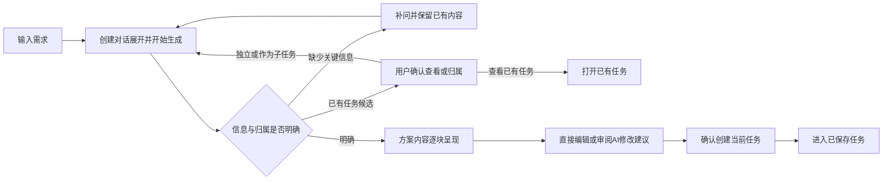

# 任务创建

## 1. 目的

把用户的需求整理为目标明确、可分工的任务方案，经用户确认后创建。

## 2. 范围和边界

- **对话创建**：所有界面新建入口进入同一对话流程，支持需求补问、已有任务识别、人员推荐与方案编辑；每次先创建当前任务，作为已有任务的子任务时沿用真实父子归属与团队层级配额。已保存任务的批量拆解由[任务详情](08-task-detail.md#独立-ai-拆解)承接。

## 3. 详细功能设计

### 3.1 整体流程

创建工作区的“三屏”指**左侧任务列表、中间任务方案、右侧创建对话**，是同一工作上下文的三个区域。发送需求后立即侧滑打开右侧对话，在其中显示处理中状态与停止入口；中间同时展示方案骨架，已到达且通过校验的内容替换对应占位。处理状态不占据中间整页，任务列表继续提供原有工作上下文。

桌面对话与方案并排，收起后方案恢复空间并保留会话；窄屏沿同一会话在方案与可收起的对话间切换，不挤成三条不可读的窄栏。需要补问时自动露出问题，补充完成并生成完整方案后回到审阅，仍可重开对话继续调整。对话收起不停止生成、不提交内容；重新展开可接续读取过程与消息。减少动态效果时直接呈现区域变化。

**创建对话入口仅在侧栏收起时显示**；打开后入口隐藏，不保留空占位或键盘焦点项。展开期间通过侧栏头部收起，关闭后入口重新出现，焦点回到该入口；再次打开后入口同步隐藏。过程对话与修改对话、桌面与窄屏使用同一规则，切换不丢输入、历史、候选或已生成字段。

### 3.2 分步处理

| 规划步骤 | 系统处理 | 用户操作与结果 |
| --- | --- | --- |
| **1. 分析需求** | 提取目的、交付内容与限制。信息不足时补问；发现疑似重复任务或可能的父任务时，展示候选及原因。 | 在当前会话补充关键信息，或选择查看已有任务、继续独立规划、作为子任务继续；没有对应分支就继续生成。 |
| **2. 生成名称与目标** | 先呈现本次工作名称及其真实目的，未到达部分保留骨架。 | 内容到达后即可直接编辑，不必等待人员和日期全部返回。 |
| **3. 生成任务完成标准** | 根据已知范围给出可核对的交付或结果，不覆盖已编辑的名称与目标。 | 审阅并编辑已经到达的标准。 |
| **4. 整理人员与日期** | 按目标、标准和团队责任域推荐人员，给出有依据的日期或保留未定。 | 核对人选与日期；未匹配负责人可保持未分配，邀请规则见[成员、邀请与任务分工](09-member-collaboration.md)。 |

**审阅与创建**

渐进生成按实际可用的内容块呈现，不用虚构百分比或仅播放步骤冒充结果到达。后续内容块只填充其对应部分，不覆盖已到达字段的人工修改。停止或失败保留输入、对话及已生成内容；不完整方案不能提交，可在当前会话继续或重试。已放弃会话的旧结果不得回填。

方案完整且校验通过后，用户可直接确认创建当前任务，也可先人工编辑或通过创建对话提出普通修改要求，审阅差异后明确应用。创建流程不提供卡片标注输入、意见列表或继续拆解操作，不以未处理标注作为创建门槛。用户在最初需求中要求拆解时保留该意图，先完成当前任务创建，再从已保存任务发起独立拆解。确认前不写入任务，创建失败保留方案，修正后重试。

**常见场景**

| 输入情形 | 处理方式 |
| --- | --- |
| “整理本次会议纪要” | 直接生成单任务。 |
| “做一次活动”但目标、交付不清 | 补问活动目的与交付内容后规划。 |
| 项目包含商务、内容、发布等工作 | 先整理并创建当前任务，需要分工时从已保存任务独立拆解。 |
| 初始需求已明确要求拆解 | 保留拆解意图；创建后进入独立拆解，候选经审阅确认才新增。 |
| 已有任务可能覆盖同一交付 | 提示疑似重复，由用户选择查看已有任务或继续新建，不自动合并。 |
| 需求可能属于已有项目 | 用户确认父任务后，作为其子任务规划。 |
| 没有匹配负责人 | 保持未分配，允许人工选择或邀请，不阻止创建。 |

### 3.3 生成的任务结构

创建方案表达当前一个新任务及其与已有任务的归属。**每个任务都保存自己的目标与完成标准**。创建子任务时可将父任务目标作为初始内容，之后独立编辑；不要求父子目标文字不同，修改父目标不自动覆盖子目标。

| 内容 | 说明与编辑规则 |
| --- | --- |
| **任务名称** | 简短说明要做什么，可编辑。 |
| **目标（目的）** | 说明为什么做、服务谁或什么工作、希望达到什么状态，可编辑；不能仅改写任务名称或重复交付物。 |
| **任务完成标准** | 有序列出可核对的交付或结果，支持新增、修改和删除，不提供拖动或上移／下移调序入口。 |
| **人员** | 一名负责人及多名参与者；负责人可为空，最终以用户选择为准。 |
| **父任务归属** | 挂在已有任务下时显示真实父任务路径，可在审阅时核对；批量子任务候选属于独立拆解。 |
| **截止日期** | 任务排期只设置截止日期，可填写或留空；不得早于创建日，按团队时区判断。方案与 API 不提供开始日期；系统创建时间独立记录。 |

**目标、标准与执行路径**

标题识别本次工作，目标说明真实用途、需要解决的问题或期望状态，不能用“完成／交付”加任务名称或产物换称代替。目标依据用户原话、已知使用场景及相关父任务上下文形成；只知道交付物时不编造销量、转化或其他收益。目的不明且不同目的会改变交付或验收时补问，已有内容保留。

“为宣传提供准确清晰的脚本”等用途前缀加产物质量，仍不足以表达真实目标。应说明有依据的使用者会因此理解什么、作出什么判断、继续什么工作，或希望改变的具体状态；不要求固定句式，也不为补齐目标增加用户测试、物料或业务指标。合理推断的最近用途须标为建议，不能当作用户已确认事实。

任务完成标准核对本次实际承诺的结果、交付、必要质量及范围约束；条件可以定性或定量，但必须可检查且有依据。步骤归执行建议，不为验收添加用户未要求的调研、会议或物料。业务目标保留已有指标和口径，但单次制作完成不自动证明用户行为或业务效果改善；探索任务区分收集证据与假设成立。

拆解时父任务保留整体目的，各子任务说明自身贡献，标准只核对本节点范围，检查关键结果无遗漏、无重复执行。父子可以复用确实适用的目标，不强制文字不同，也不把父任务全部业务结果交给每个子任务单独保证。

**截止日期建议**

用户未提供日期时，对范围清楚、可合理排期的有限任务生成可修改、可清除的 AI 建议截止日期，并提供对应任务、日期依据和关键假设供核对。实际可用时间与工作日历未知时明确说明，不把人工工时直接当成日历历时。持续工作、没有整体结束点的长期目标或关键等待无法判断时允许留空；有充分范围与安排的长任务仍可建议日期。

交付对象、规模和用途已明确时，缺商城尺寸、共享渠道等可补规格，不单独构成取消初始日期建议的理由；可以假设制作前补齐并说明未补齐时需重新评估。用户明确这些规格须等待外部确认且回复时间未知，或缺口会实质改变范围而无法合理假设时，才按关键等待或范围不足留空，不把假设写成已取得承诺。

用户明确日期优先；明确不设截止、手动清空及已有编辑在后续优化中保留，只有明确要求重新排期才调整。日期建议不冒充已落实安排；确认后的计划截止与执行中根据实际进展生成的完工预测分别处理，预测不静默覆盖计划截止。

创建审阅采用单列字段，不展示执行提示、预计投入、负责人推荐理由及标签。创建任务 Skill 根据目标与完成标准生成初始预计投入，任务保存成功时保留为 AI 估算及创建基线；确认创建不等于人工确认估算。估算绑定有效任务范围，范围未知或不匹配时保留待评估，不补零、不因缺估算阻止明确任务创建。其他未审阅的隐藏字段不作为用户已确认事实提交；后续投入分析见[任务进度与完成](12-task-progress-completion.md)，标签规则见[任务详情](08-task-detail.md)。输入框聚焦后隐藏占位提示，输入内容后才显示键盘操作提示。截止日期支持未来 1、3、7、10、30 天快捷选择及日历选择，确认后生效。

**继续对话与调整**

用户在创建对话输入修改要求，系统以最新方案为基础生成对应字段的修改前后差异，保留未要求修改的内容。预览本身不改方案，明确应用后才更新草稿，最终确认后才创建任务。

调整失败、停止或取消时保留要求与人工编辑；生成预览后方案发生变化，原预览失效，须基于最新内容重新生成。收起对话保留输入、历史与候选，重开可继续；子浮层先处理 Escape，对话再处理自身收起，隐藏区域不进入键盘顺序。文件标注遵循[文件与成果提交](11-files-local-commits.md#33-内容标注与修订意见汇总)。

### 3.4 规则与限制

- **初始状态**：新建主任务及子任务默认为进行中；不据此生成完成量或 AI 进度，状态修改见[任务详情](08-task-detail.md)。
- **关系与估算边界**：方案只表达父子归属，不包含前置依赖字段，包括空的兼容字段；所需材料及交付顺序保留在任务内容中。投入的内部工作明细不自动创建为子任务，父级按有效叶子去重汇总。

- **人员生效**：创建者默认加入每个新任务的参与者；本人已为负责人则不重复显示。审阅时可移除自己，之后不自动加回。团队内人员随任务保存生效；团队外人员按团队邀请处理，接受前不视为正式任务成员。
- **层级配额**：沿用团队实际配额，默认最多 **10 层**，任何配置均不得超过 **20 层**。根任务为第 1 层，每个任务最多一个同团队父任务，禁止自归属和循环。创建、批量创建、移动及恢复都按完整父链计算绝对深度；移动或恢复分支还须计入全部后代的高度。达到团队配额的任务不能继续加深，超限须调整后提交。历史超限数据不截断；深度配额不作为任务总数上限。
- **方案保留**：确认创建前，输入、对话和预览方案只属于当前创建会话，不是已保存任务。切换方案步骤或返回仍保留本次会话的输入步骤时不丢失；退出后重新进入为空白，不恢复草稿。主动返回任务、关闭创建、打开其他任务或模块、切换团队时，只要本次会话已有非空输入、对话或方案，先打开离开确认：说明尚未创建，离开后本次输入和方案将丢失。选择继续编辑或关闭弹窗时停留原处并保留内容；明确放弃后才清理本次会话并执行离开动作。空白会话及已确认创建成功的任务不弹确认。刷新或关闭浏览器时使用浏览器自身的未保存提示，文案以浏览器为准；确认离开后不恢复本次方案。
- **统一提交**：全部任务、关系与人员选择一起成功或失败，不留下半套任务或创建通知。同次重试不重复创建，已提交成功的任务不因退出而丢失。
- **独立邀请**：用户显式发出的团队邀请不因方案退出或创建失败撤回，也不因此提前创建任务。

### 3.5 异常处理

| 情况 | 系统响应与下一步 |
| --- | --- |
| 输入为空 | 提示填写需求，不开始规划。 |
| 正在规划或提交 | 显示处理中，避免重复发起同一次操作。 |
| AI 规划或重新生成失败 | 保留原输入与已有方案，可在当前对话重试。 |
| 生成中停止或失败 | 保留已经到达的字段、人工修改与未完成状态；创建不可用，可继续或重试，不用空值冒充已生成。 |
| 调整失败、停止或取消 | 不应用部分差异，保留修改要求及当前方案，修正后重试。 |
| 调整预览后草稿发生变化 | 原预览失效，保留要求与最新人工内容，重新生成差异后才能应用。 |
| 有未创建内容时主动离开 | 先确认是否放弃；取消保留当前内容，确认后才清理并离开。正在生成的旧请求或迟到结果不得恢复已放弃方案。 |
| 清理本次会话失败 | 保留方案和确认弹窗，提示重试；可以返回继续编辑，不在清理失败时离开。 |
| 人员、父任务或权限发生变化 | 提交时重新校验，定位需调整的项；保留方案，不提交部分任务。 |
| 层级或日期不合法 | 标记问题任务，用户修正后再提交；不静默删减或改写。 |
| 提交结果未知 | 先查询同一次操作的结果，再决定是否重试。 |

移动端与键盘操作均能完成补问、关系选择、方案编辑、对话调整及确认，不依赖悬停才能看到关键操作。无权限时不提供可提交操作；权限改变时重新校验，保留允许查看的内容与可恢复路径。

## 4. 功能验收标准

- 方案与 API 只返回截止日期及其依据；未确定时可为空，不因缺少开始日期阻止规划或创建。
- 有限且可合理排期的任务在未给日期时提供有依据的 AI 建议，普通可补规格与时间未知的关键外部等待分别判断；持续、无自然结束点或关键等待未知的任务可不设日期。用户日期、主动清空和已有方案在未要求重排时保留，日期不得早于创建日。
- 结果指标保留用户口径，不编造基线、目标或成效；交付任务不被强加业务指标。验证任务只收集证据时，无成功阈值仍可生成，但不能将收集完成描述成假设成立。
- 目标能说明本次工作为什么需要，不能只把标题改写成完成或交付某产物，也不能仅以用途前缀和质量词通过判断；目的缺口影响交付或验收时补问，不以虚构业务收益填满。父子目标与标准按实际贡献和范围对应，不按文字是否相同判定合理性。
- 信息明确时直接生成方案；缺失关键信息时先补问，回答反映在目标与完成标准中。
- 疑似重复与父任务候选均须用户选择；查看已有任务不会产生新任务，确认父任务后显示正确归属。
- 当前任务与挂在已有父任务下的新任务均可审阅；保存自己的目标、完成标准与人员选择。子任务可保留与父任务相同的目标，并可独立修改；批量拆解在已保存任务中独立发起。
- 默认配额下第 10 层可保存，第 11 层被拒绝；团队配额调整后按实际值校验，任何路径不得超过第 20 层。循环、跨团队关系或挂到已有父链后超限时拒绝整份提交，保留方案。
- 未选负责人仍可创建，创建者默认能在“我参与”找到任务；选择本人负责时不重复列为参与者。
- 对话方案确认前不产生任务；有输入、对话或预览时，从返回、关闭、其他任务／模块或团队切换入口离开均需确认。取消及关闭确认弹窗保持当前位置和方案；确认放弃后重新进入为空白，已发出的旧请求不得回填。空白会话或创建成功后离开不弹确认，已成功任务不受影响。
- 多任务方案任一项写入失败时，全部任务和关系均未创建；同次重试成功只创建一份。

- 发送需求立即展开右侧创建对话并呈现处理中状态，中间同时出现方案骨架；名称／目标、标准、人员／日期按实际到达依次替换，已到达字段可编辑，后块不覆盖这些编辑。
- 停止／失败保留输入、对话及已生成字段；不完整方案不能创建，继续／重试后只接续有效结果，旧请求不能覆盖当前会话。
- 创建界面无卡片标注入口、标注输入／列表、未处理标注门槛或继续拆解操作；普通 AI 修改仍先预览、明确应用，再确认创建。
- 复杂度、估算明细或初始拆解要求不在创建中自动写入子任务；用户可先创建当前任务，再从已保存任务独立拆解。
- 初始 AI 投入在创建审阅中不可见，保存后仍可作为分析依据；未被用户人工确认的估算不标记为已确认。当前方案不返回前置依赖字段。

- 人工编辑与 AI 调整使用相同的任务字段和父子归属范围；所需材料和交付顺序保留为相关任务的内容要求。
- 创建对话打开时，桌面任务列表、方案与对话保持可辨的并排区域；窄屏内容完整可读且可在同一会话收起／重开对话。收起不停止、不应用、不清空；键盘及减少动态效果可用。
- 收起状态仅显示可打开创建对话的入口；展开后入口及其焦点项消失。头部收起或Escape关闭后，入口恢复且获得焦点，重开再次隐藏；过程与修改对话均不遗留重复入口或丢失会话。
