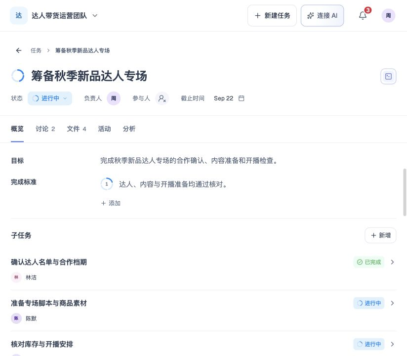

# 任务详情

## 1. 目的

在同一个任务内查看目标、维护信息并继续协作。

## 2. 范围和边界

- 维护任务信息，并通过概览、AI、讨论、文件和活动继续协作。
- 权限以[权限、异常与质量要求](15-permissions-errors-nfr.md)为准。

## 3. 详细功能设计

### 3.1 概览 Overview

详情页签按概览、讨论、文件、活动、分析排列；分析放在最后，支持同一组方向键、Home 和 End 导航。任务顶部使用中性背景，不随任务色显示渐变。顶部信息、页签及概览、讨论、活动与分析正文使用一致的左侧留白；图标后的文字及时间线内容保留各自层级缩进。

#### 页签数量

讨论与文件页签名称后显示灰色总数：讨论统计当前任务有效的主消息和回复，不包括已删除消息、文件内讨论、活动记录及未发送草稿；文件统计当前任务有效文件，不包括文件夹、已归档或已删除文件及历史版本。搜索和筛选不改变页签总数。0 至 99 显示实际累计值，超过 99 显示 99+；悬停或可访问名称提供实际数量及计数含义，尚未取得数据时不把未知显示为 0。

标题前的四段圆环是整任务进度与人工确认入口，交互与单条完成标准一致。状态字段支持修改任务状态，AI 分析页提供详细评估。

任务标题保持单行，超出可用宽度时以省略号展示，可查看完整标题；编辑时保持单行并支持横向查看完整内容，按 Enter 结束编辑，中文输入法组合输入不触发提交。

查看和编辑目标、完成标准、子任务与标签，参考 AI 分析推进任务。

#### 完成标准与人工确认

- 逐条查看任务完成标准的 AI 标准评估与依据，**负责人**和参与者均可人工确认或撤销。
- **人工确认**记录确认人、时间及标准版本，与 AI 分析分别保存。
- 修改该条标准的实质内容后旧确认失效，改排序不使确认失效。
- 新增条目未确认，删除条目不把旧确认转移给其他条目。
- 保存**失败**保留原状态。

四段圆环表示整任务 AI 评估。悬停或聚焦出现确认勾，人工完成后显示完整圆环与中心勾，再次悬停或聚焦显示撤销。**点击按钮即标记整个任务完成，再次点击撤销**，不要求逐条标准先确认。常驻视图仅保留图形；悬停或键盘聚焦显示 AI 完成阶段、对应的评估依据与确认／撤销说明，不展示百分比或已确认条数。评估依据与所展示的 AI 进度来自同一记录；未提供依据时不补写推测性说明。没有 AI 评估时保持未填充并在提示中说明暂无评估。只读时可以查看评估，不能改状态。人工完成时以完整圆环与中心勾替代 AI 分段，但不修改 AI 评估、依据或逐条标准确认；撤销恢复完成前状态与原有 AI 段数。逐条确认最后一条有效标准后自动完成；撤销标准确认时已完成任务恢复完成前状态。

*FIG-DETAIL-002：任务概览中查看目标、任务完成标准和子任务，页签显示讨论与文件数量。*

### AI 分析

有当前任务范围内有效的进度评估或完成量依据时，才显示最后的分析页签；只有名称、流程状态或估算时不显示。未知、无依据或范围失效时不预留分析空面板。有效的零完成量记录属于有依据的评估，仍可展示。依据消失时，正在查看的分析回到概览；新依据生效后恢复入口。

分析页签展示进度、燃起图、当前情况与下一步建议。“重新分析”刷新评估，不改写任务信息、结构、状态或人工标准确认。需要修改任务时，在概览中编辑对应字段；新增子任务通过概览的新增入口进入创建流程。

标签按任务内容自动生成，用户可增加和删除；人工标签保留，已删除标签不因重复分析被自动补回。标签属于任务，不修改个人标签目录。

### 3.2 讨论 Discussion

围绕任务交流进展、提问和回复，可引用附件、查看原文。

### 3.3 文件 Files

1. 在文件树中选择资料。
2. 预览文件内容。
3. 编辑文件或查看版本。

默认打开最新版本，引用固定版本并标明版本号，详见[文件与成果提交](11-files-local-commits.md)。正文保留原文，提交不自动完成任务。

### 3.4 活动 Activity

按时间和类型追溯变更，返回对应讨论或文件；活动与讨论分开。

### 3.5 状态与完成后的维护

#### 状态操作

- 任务状态由**负责人**或参与者直接设置。
- 可在进行中、已阻塞、已完成、已取消之间修改，不增加审批、**负责人**专属完成或强制完成核对页。
- 标准未全确认、没有附件、子任务未完成不阻断用户选择已完成。
- 进行中任务的状态图标与标题进度入口使用同一四段圆环；有有效 AI 进度时按相同梯度填充，未知时不填充。详情状态选择菜单的进行中选项读取当前任务的同一份有效 AI 进度，段数与外层列表和状态字段一致；未知时保持未填充。当前任务已完成时，菜单中的进行中选项显示四段全亮圆环，表示可切换的状态样式。状态筛选的进行中选项显示四段全亮圆环，表示筛选类别。
- 已阻塞使用警告三角图标，标题进度入口继续显示 AI 评估。已完成统一显示完整圆环与中心勾，已取消显示圆环与叉；标题、状态与列表使用同一状态颜色。状态文字说明流程状态，图形不反向生成完成量。
- 历史待开始任务归入进行中，已有目标、标准、人员、日期和进度依据保持。旧状态筛选兼容为进行中。
- **任务状态**不能反向填充 AI 进度。

#### 完成后的修改

已完成任务仍可编辑目标、标准、人员、文件和子任务，保存后不自动重开。重新分析及人工确认失效按所属规则处理；用户需要时自行修改状态。

### 3.6 子任务归属与删除

- 子任务支持独立打开、编辑、设置状态，层级统一遵循[任务创建的**四层**上限](07-task-creation.md)。
- 新增子任务也通过对话生成待确认方案。
- 任务关系只表达父子归属，相关材料要求和交付顺序由目标、完成标准或执行建议说明。

仅当前任务负责人可发起删除。删除整个分支及二次确认见[删除与数据保留](13-deletion-recovery-retention.md)，不能将删除子任务当作普通内容编辑绕过权限。

## 4. 功能验收标准

- 负责人和参与者均可修改状态；无负责人时参与者也可设置已完成，不要求标准或附件先通过。
- 已完成任务新增标准后仍为已完成，新条目未确认且触发 AI 分析；仅改排序不清空原确认。
- AI 结果更新不覆盖人工确认；保存失败不改变确认计数或任务状态。
- 切换详情 Tab 保留当前任务和面板内未提交输入；这不等于创建对话退出后恢复方案。
- 第 4 层任务不能继续创建子任务；非负责人不能直接删除该任务。

- 整任务确认与逐条标准确认、AI 评估独立；无权限时只能查看提示，不可操作。

PM demo 的任务详情支持直接修改状态，不因当前用户未被分配到任务而隐藏状态下拉。修改写入本地任务状态并记录活动；正式项目权限边界另行实现。

- 标题圆环在点击、Space 与 Enter 操作后同步状态；人工完成后显示完整圆环与中心勾，撤销恢复原状态与 AI 段数，逐条标准记录保留。
- 按钮不常驻阶段文字或确认数量；提示可读且不被详情滚动区遮挡，只读时点击不改变状态。

- 无有效分析依据时，分析入口和面板均不进入页面或键盘导航；有效依据恢复后可正常打开分析。
- 讨论与文件总数遵循各自有效数据范围，搜索不改总数；0 至 99 显示实际值，超过 99 显示 99+，实际数量可通过键盘及辅助技术读取。
