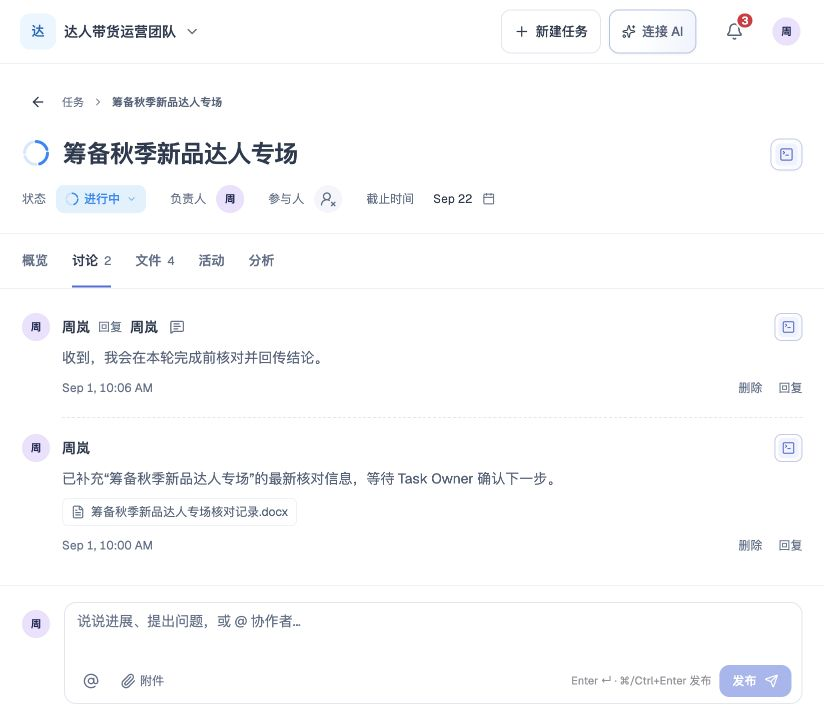

# 讨论、通知与活动

## 1. 目的

让团队沟通、待处理提醒和变更记录各有明确入口。

## 2. 范围和边界

讨论用于交流，通知提醒处理，活动追溯变化。

## 3. 详细功能设计

### 3.1 讨论与引用

任务成员可发讨论、回复、@ 提及和引用文件。任务讨论中的主消息与回复在同一列表按发送时间倒序逐条展示，最近消息在最前；回复标明对象，引用内容按需预览，不常驻展开。

任务讨论页签的累计数量遵循[任务详情的页签数量规则](08-task-detail.md#页签数量)。

悬停或键盘聚焦姓名后的引用图标可预览原消息，预览只显示引用内容。点击或键盘激活图标直接滚动到对应原消息，触屏同样一次点击完成定位；定位后不高亮原消息。原消息已删除或不可用时显示对应提示，不展示旧正文，也不提供定位。

阅读消息时可直接回复任意一条。发布与回复共用底部输入区，选择回复后显示对象与摘要，可定位原消息或取消回复；切换回复对象保留未发送内容。

每条已发布任务消息提供独立的连接 AI 入口，用户可围绕所选消息继续处理；工具选择、连接方式与带入内容遵循[Agent、CLI 与 MCP 连接](05-cli-connection.md#任务与讨论上下文)。输入区只负责草稿编辑与发布，不提供草稿连接 AI 入口。文件内讨论仍按文件中的原有线程阅读和回复，与任务消息流分别维护。

- 任务讨论中的主消息与回复发布后不可编辑；作者可通过回复旁的删除操作移除自己的发言，其他成员不显示删除入口。
- 删除原消息后保留回复结构与“原消息已删除”提示，不提供恢复。
- 文件引用固定当时版本，按[文件与成果提交](11-files-local-commits.md)查看。
- 消息阅读与词条复用遵循[语言、翻译与时区](02-internationalization.md#33-自动翻译讨论内容)，原文用于引用。
- 发送失败保留输入与回复对象，重试不重复发布；只读时可阅读和定位，不能发送或删除发言。

@ 只选择有权读取该任务的团队成员，不因提及扩大权限。活动是只读变更记录，不能由用户或 Agent 随意编辑删除。

任务讨论、文件讨论、通知与活动的日期时间遵循[全局日期显示规则](02-internationalization.md#34-日期与时区)，读取记录已有的时间信息，不以显示文案推算时间点。

*FIG-COLLAB-004：任务主消息与回复提供本人删除及回复操作，页签显示讨论与文件数量。*

### 3.2 通知事件与接收人

本期业务通知进入站内通知中心；团队邀请另发邮件，未注册者通过邮件继续加入。不新增其他事件邮件订阅。任务成员指负责人和参与者，下表接收人默认排除操作者本人。

| 事件 | 接收人 | 打开位置 |
| --- | --- | --- |
| 团队邀请发出／重发 | 受邀邮箱；账号存在时同时形成站内提醒 | 同一团队邀请确认 |
| 接受／拒绝团队邀请 | 邀请发起人；接受后的成员加入消息与下条合并 | 邀请结果或成员列表 |
| 成员加入团队 | 团队其他有效成员 | 成员列表 |
| 任务交接完成 | 每位接手人按本次交接接收汇总，仅含其有权任务 | 我负责的／我参与的任务范围 |
| 成员离开或被移出团队 | 团队其他有效成员；被移除者收到不含后续团队数据的结果说明 | 成员列表或结果说明 |
| 设置／修改负责人、加入／移出参与者 | 变更前后任务成员的并集；被移出者只看结果说明 | 任务或移出说明 |
| 任务状态改变 | 当前任务成员 | 任务及状态变更记录 |
| 目标、任务完成标准、截止日期改变 | 当前任务成员 | 任务中的对应内容 |
| 人工确认／撤销标准 | 当前任务成员 | 对应标准 |
| 发布讨论 | 当前任务成员 | 对应讨论 |
| 回复或 @ 提及 | 被回复者、被提及者；与同一条讨论提醒合并 | 对应消息 |
| 新增文件／文件版本或删除文件 | 受影响任务的成员 | 对应版本或删除结果 |
| 新增／删除子任务 | 父任务成员；删除时合并通知被删分支成员 | 父任务或删除结果 |
| 删除任务及后代 | 被删除范围的任务成员 | 删除结果说明 |
| AI 自动分析完成、只读访问、置顶、通知已读 | 不发通知 | 在原任务内更新即可 |

### 3.3 合并与已读

- 同一次事件、同一人只生成一条提醒。
- 一次保存改多个字段合并，回复与 @ 合并，多层任务创建或删除按**同一次操作**汇总。
- 人员退出引起的批量任务交接合并提醒，避免按任务逐条轰炸。
- 重试不重复发**通知**，业务未成功不发成功通知。
- 投递**失败**不回滚已保存的任务或讨论。

通知可筛选全部、未读、已读，打开后标记已读，支持全部标为已读。已读不等于确认任务、接受责任或修改状态。打开时校验当前访问权；来源删除或失权只显示必要结果，不继续暴露正文。

### 3.4 活动记录

活动按时间倒序展示已保存的字段、人员、状态、**人工确认**、讨论、文件及删除等业务变化。时间线保留动作图标，操作人头像放在姓名前，与动作、对象和时间共同呈现；动作文字后显示对应的活动类型标签。点击讨论动作文字可返回对应讨论，文件引用可打开对应来源。

文件提交活动的内容仅为本次提交的文件引用，在提交动作下方独立呈现，不附加自动生成的说明。文件名称可完整读取，多个引用在窄屏按需换行。

用户可按活动类型和操作人筛选，两项条件共同生效。人员采用单选，包含全部人员及本任务活动中实际出现的操作人；选择依据为稳定人员身份，同名人员不合并。无法确认身份的记录保留原署名，不归给同名成员。切换类型不清除人员条件，恢复全部人员不清除类型条件。

人员筛选使用统一的紧凑单选菜单，可按姓名、职责或邮箱查找当前候选人。搜索只缩小候选列表，不改变已有筛选条件；选人后应用该人员条件，关闭列表后清空搜索词。

- 筛选无匹配时提示调整条件；任务尚无活动时说明还没有记录。
- 来源已删除或不可用时保留活动记录与必要提示，不跳转到其他同名对象。
- 讨论正文在讨论区维护，不把 AI 建议或**通知**状态当成任务事实。
- 无实际变化不产生新活动；活动与**通知**独立，通知清理不删除业务记录。

## 4. 功能验收标准

- 一条同时回复并 @ 同一人的消息只产生一条提醒；同次请求重试不重复消息或通知。
- 添加有效成员立即生效并通知，无需通过通知再接受任务；待加入人员在加入前不收到任务正文。
- 被移出后只能查看移出结果，不能通过旧通知读取任务；标为已读不改变任何业务状态。
- 发布讨论或修改任务成功但通知投递失败时，原内容仍保存；未成功写入不生成成功提醒。
- 本人发言的删除操作直接可用，他人发言不显示删除入口，删除他人讨论被拒绝；删除自己的原讨论不删除其他人的回复，也不提供恢复入口。
- 主消息与回复各出现一次并按时间倒序排列，不提供独立的同串阅读入口。
- 讨论、通知与活动的时间呈现符合全局日期规则；来源缺少完整时间时不补造，语言切换不修改记录或顺序。
- 引用图标悬停或键盘聚焦可预览原消息，预览不显示定位文字；鼠标、键盘及触屏激活图标均直接滚动到对应原消息且不增加高亮，原消息已删除或不可用时不泄露正文、不触发定位。
- 回复对象可取消，@、附件与作者删除操作在消息流中保持可用；任务主消息和回复均无编辑入口及空更多菜单，删除与回复文字字号一致。通知仍打开对应消息，文件内讨论保持线程阅读。
- 每条已发布任务消息可直接使用连接 AI 主按钮及工具下拉，操作关联所选消息自身的讨论 ID，带入范围符合连接模块规则；移除输入区草稿连接 AI 入口后，输入保留、切换回复对象及正常发布继续可用。
- 活动中的头像、姓名与所记录操作人一致；同名人员可分别筛选，类型与人员条件叠加后只显示同时满足的记录。
- 调整任一筛选不会清除另一项条件；筛选无匹配和任务没有活动显示不同空状态，筛选不修改原记录。
- 人员搜索只返回当前候选范围内的匹配项；无匹配时保留原筛选，键盘可选择并关闭列表，关闭后焦点回到人员筛选入口。
- 文件引用可通过鼠标与键盘打开对应来源；长文件名和多个引用在窄屏不遮挡动作或时间，来源不可用时不误跳转。
- 文件提交活动在提交动作下方显示本次文件引用，不追加说明行。
