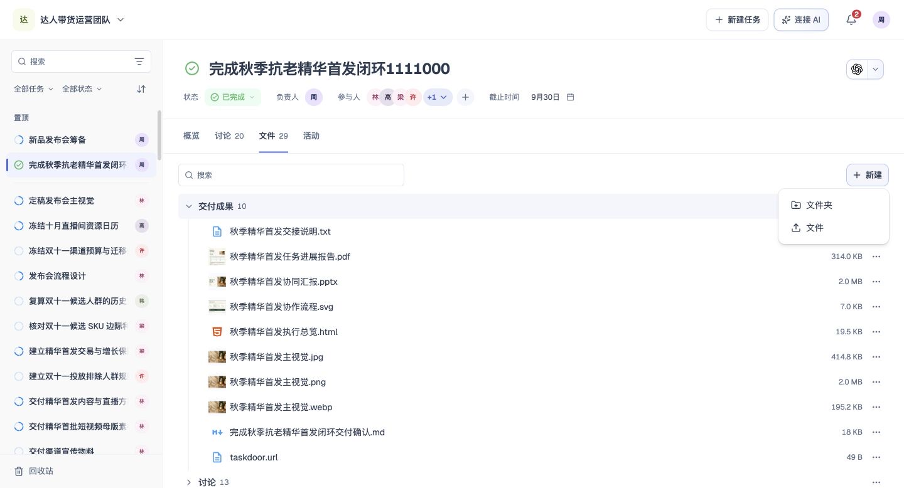
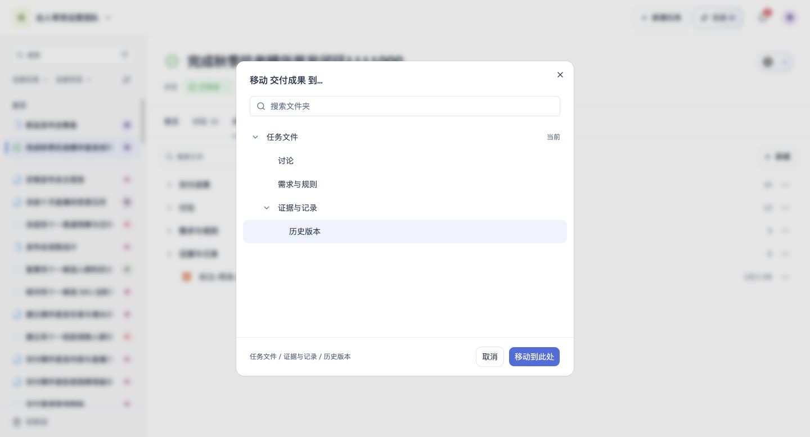
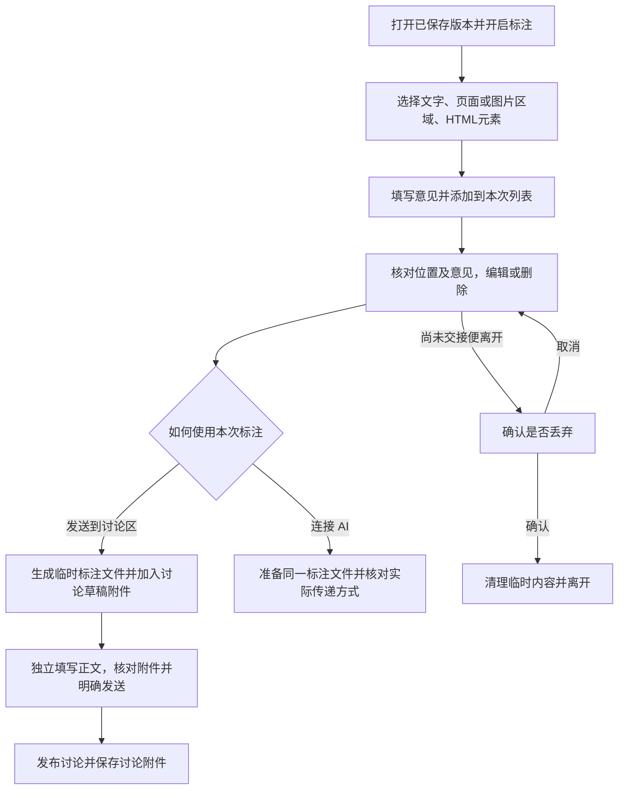

# 文件与成果提交

## 1. 目的

让任务资料与交付成果集中保存、查阅和讨论，并将针对内容的修订意见准确交给执行者。

## 2. 范围和边界

覆盖任务文件与文件夹的浏览、整理、上传、预览、编辑、版本管理、内容标注、修订意见汇总及成果提交。标注和意见交接不直接改写文件；成员在本地 Agent 完成修改后，将新产出上传为独立文件。

## 3. 详细功能设计

### 3.1 文件浏览、整理与上传

文件页签以**同页树状列表**展示当前任务的有效文件与文件夹，每项呈现名称，文件显示可用封面或类型图标。首次普通进入时文件夹默认收起，不自动打开文件；通过文件夹行或折叠箭头在原位置展开、收起，层级缩进表达父子关系，多个文件夹可独立展开。文件夹显示实际直接内容数量，空文件夹显示0，不生成占位文件。鼠标、触屏与键盘使用同一开合规则，收起内容不进入键盘顺序；深层内容可在树区域内横向读取，不撑破页面。

**搜索覆盖整个任务**，不受文件夹收起状态限制。名称命中的文件与文件夹保留祖先层级，自动展开以说明来源；命中文件夹可继续展开其有效后代。搜索数量只统计名称实际匹配的项目，不把为显示来源而补充的祖先或后代算作命中。自动展开不改写普通浏览的开合状态，清除搜索后恢复普通树；用户在搜索中明确定位或开合时，仍按对应目录操作处理。无匹配时说明结果并可清除搜索。

文件页签下直接提供**搜索与新建**，同排显示并保持可达；目录开合和搜索不额外插入标题或路径导航行，下方目录树在原位浏览。

添加位置初始为任务根目录；展开文件夹或打开文件时，分别将该文件夹或文件所在目录作为添加位置。折叠当前目录或其祖先时，添加位置退到被折叠目录的父级，收起根级文件夹后回到任务根目录。上传与新建窗口显示目标路径，供提交前核对。数量使用数字，辅助阅读保留完整含义。

点击或键盘激活文件，在**大型预览弹层**中查看；目录树保留在背景，弹层不显示文件树。仅用方向键移动焦点不打开文件。通知或活动指定有效文件时，直接打开对应文件与固定版本，并展开背景中的必要祖先以定位来源。讨论附件复用相同查看和编辑能力，入口及返回遵循[讨论附件查看与返回](10-discussion-notifications-activity.md#讨论附件查看与返回)。缺失或不可用目标显示必要提示，不打开同名替代文件。菜单操作独立，不同时打开文件或改变文件夹开合。

文件封面按下方[真实内容封面](#真实内容封面)规则展示，名称保留扩展名，长名称仍可读取。文件和文件夹不提供自定义图标入口，整理仍从原菜单执行。

**新建按钮**提供**文件夹**与**文件**两项：文件夹进入新建文件夹窗口，以“新建”提交；文件进入本地上传窗口。空目录仍可使用。上传处理中只禁用再次上传，其他有效操作保持。上传与新建默认落在**当前添加目录**，新建窗口可明确选择其他有效目录。上传仅接收本地文件，支持选择或拖入；目标位置、处理进度和重复发起限制清晰。成功后以新的文件身份加入目录，同级同名文件追加编号，不覆盖原项或追加到其版本历史；失败显示原因并可重试。目标已不可用时停止添加并提示重新选择，处理期间的整理不被上传结果覆盖。

普通任务文件的单文件上传上限显示为**1GB**，这是产品标称，实际按**1GiB（1,073,741,824字节）**校验。选择文件与拖入文件使用同一上限，超限时在读取、暂存原件前拒绝并提示；该上限仅适用于普通任务文件，不扩大讨论附件的容量范围。具体文件大小仍按下方十进制规则展示，不用1GB标称反推十进制字节数。

*FIG-FILES-102：目录数量紧随名称，新建菜单提供文件夹与文件两项。*

*FIG-FILES-103：窄屏搜索与新建同排，文件夹在原位展开。*

*FIG-FILES-106：新建文件夹时，窗口与任务背景清楚分层。*

*FIG-FILES-107：上传窗口明确普通任务文件的单文件容量上限。*

文件阅读工具栏提供明确可见的**下载**入口，并按能力提供全屏、标注、编辑及更多操作；普通文件下载不在更多菜单中重复，版本记录与修订包仍按原入口使用。不可编辑、不可全屏等限制继续适用，不为不可用操作显示入口。开启标注只切换标注模式，已有内容从标记或标注列表按需查看。

支持全屏的文件在阅读状态可**全屏查看**。全屏只展示文件内容，始终提供退出图标，也可按Esc返回；退出后保留当前文件与阅读位置，并将键盘焦点返回全屏入口。浏览器不支持全屏、预览不可用、读取失败或正在编辑时不提供全屏入口；音频不提供全屏，视频沿下方播放器规则。

围绕文件的交流统一在任务的[讨论](10-discussion-notifications-activity.md#31-讨论与引用)进行，文件内专注预览、编辑和标注，不设置独立讨论入口、消息数量、正文讨论气泡或讨论面板。标注工具条可将标注文件发送到讨论区，带入内容及发布边界见下方标注流程。

#### 移动文件与文件夹

从文件或文件夹的更多操作进入移动窗口，在**当前任务根目录及有效文件夹**中选择目的地。目录按实际层级展示，可独立展开、收起；按文件夹名称搜索时，找到收起层级内的匹配项并保留其祖先来源，不将未匹配的后代扩成结果。清除搜索后恢复普通开合状态，无匹配时可清除重选。

每次只选择一个目标，底部保留所选路径；即使搜索隐藏该行，也不自动改选。**当前**始终标记文件实际所在位置，不随目标变化。鼠标、触屏或键盘选行只改变目标，折叠箭头只开合；明确选择**移动到此处**后才提交，取消或Esc退出不移动文件。

**同位置不能提交移动**；文件夹自身、后代、归档及其他不可用目录不能成为有效目的地，同名目录按实际层级与身份区分。提交前重新核对对象与目标；失效或移动失败时保留选择并说明原因，可重新选择或重试，不自动改存根目录。

*FIG-FILES-104：树状选择移动目标，底部核对所选路径，再明确提交。*

*FIG-FILES-105：窄屏同样可选择目录并使用底部操作。*

#### 真实内容封面

文件列表、讨论附件及未发布的附件草稿使用同一套封面规则，优先展示**对应文件与版本的真实画面**：图片使用原图，MP4选取首个可用的非黑画面，PDF使用第一页。提取视频封面不播放视频，也不产生声音。

PPT／PPTX优先使用原件内嵌封面或已有的同版本静态预览；没有时，在文件卡片进入可见范围后复用现有预览转换生成第一页封面，不要求先打开文件。HTML／MD仅在已有可用图片预览时复用，不自动将正文生成封面。纯文本和音频使用类型图标。

没有可用画面、读取失败或无法确认引用版本时，回退到类型图标；未知类型使用通用文件标识，不用新版或其他文件的图像补齐。封面读取不修改文件、版本或讨论草稿。

#### 文件大小

文件大小根据可核实的原始字节，以**1000为进位**显示B、KB、MB、GB等十进制单位，显示换算不改变原始字节、文件内容或实际容量限制。普通任务文件的上传上限采用[单独约定的1GB产品标称与字节界限](#普通任务文件上传容量)。

有真实字节时优先按字节换算，不由旧显示标签覆盖。缺少可靠原始字节的历史记录保留已有标签，不从标签反推或补造字节；没有可用大小时不以0冒充。

#### 文件下载

文件、已发布讨论附件和未发布附件草稿的预览均提供**独立可见的下载入口**。下载草稿附件只取回已准备的材料，不发布消息或保存为任务文件。

下载内容对应**当前查看的已保存版本**：文本使用该版本的完整源码并保留文件名及扩展名，其他格式使用该版本可读取的原始字节；图片只有可读取的原图地址时也下载原字节，不以画布重绘或缩略图替代。未保存编辑不混入下载，历史引用不被当前新版替换，下载不生成新版本。

仅有历史PDF／Office摘要或预览快照而缺少原件时，禁用原文件下载并说明原因，不将摘要或预览文件冒充原件。读取失败保留错误提示并允许重试，不下载空白占位或替代材料。

#### 支持格式与操作边界

**新上传仅接受下表格式**，选择文件与拖入文件使用同一范围。同批包含不支持文件时整批停止添加，说明对应文件与支持范围，已有文件保持；不创建成功文件或用预置正文冒充预览。读取失败与格式不支持分别反馈，扩展名被识别不代表内容已成功读取。

新上传的较大文本及HTML保留可下载原件，不在上传时强行读取完整正文。超出当前直接预览处理能力时，明确提示**“文件较大，请下载后查看。”**并提供原件下载，不将处理窗口当作上传容量限制，也不用截断片段冒充完整正文。

| 文件格式 | 预览样式 | 具体标注操作 | 是否允许编辑 | 下载内容 |
| --- | --- | --- | --- | --- |
| PDF | 原分页与版式阅读，页码、缩放及适宽 | 选同页文字或框选页面区域并填写意见；无文字页自动使用区域标注 | 否 | 当前查看版本的原始PDF；标注不写回原件 |
| PPT／PPTX | 转换后的真实静态幻灯片，逐页阅读及缩略图定位 | 转换页可选字或主动框选图表等区域；无文字页自动使用区域标注 | 否 | 当前查看版本的原始PPT／PPTX，不以预览PDF替代 |
| PNG／JPG／JPEG／GIF／WebP／SVG | 完整图片阅读，支持缩放、平移及可用时全屏 | 框选矩形区域并填写意见，保留区域与局部截图 | 否 | 当前查看版本的原始图片；不将标记合成到原件 |
| MD | Markdown文档阅读 | 选择正文文字并填写意见 | 是，可视或源码编辑并保存版本 | 当前查看版本的Markdown文本 |
| TXT／LOG | 纯文本阅读，保留原文布局 | 选择文字并填写意见 | 是，编辑文本并保存版本 | 当前查看版本的文本，保留原扩展名 |
| HTML／HTM | 隔离的静态页面预览 | 选择页面元素或对应区域并填写意见，不提供选字标注 | 是，仅编辑HTML源码并保存版本 | 当前查看版本的HTML源码，保留原扩展名 |
| JSON | 等宽源码，保留空白、缩进及换行 | 选择准确源码文字并填写意见 | 是，编辑源码并保存版本 | 当前查看版本的JSON源码 |
| XML | 等宽源码，保留空白、缩进及换行 | 选择准确源码文字并填写意见 | 是，编辑源码并保存版本 | 当前查看版本的XML源码 |
| MP3 | 音频播放、进度、时间与音量控制 | 不提供 | 否，只读播放 | 当前查看版本的MP3原文件 |
| MP4 | 视频播放、进度、时间、音量及可用时全屏 | 不提供 | 否，只读播放 | 当前查看版本的MP4原文件 |

编辑还须满足文件权限及版本规则，未保存的草稿不代替已保存版本下载。下载不生成新版本，文本格式不能退回首次上传的旧内容。PDF、演示文稿和图片不提供正文编辑、历史文本恢复或替代原件的保存入口；预置文本快照不成为可编辑的PDF原件。

**暂不接受**DOC／DOCX、XLS／XLSX／CSV／TSV、ICS、其他音视频格式、压缩包、MDX、其他源码和专业格式的新上传。支持范围调整不自动删除已有用户资料、已修改内容或历史引用；原件可用时仍可从原关联取回，无法预览时如实说明，不用示例内容补齐。

#### MP3与MP4播放

任务文件与讨论附件中的MP3、MP4可只读播放，提供播放／暂停、进度定位、已播与总时长、静音及音量控制。MP4可在浏览器允许时进入和退出视频全屏；音频不显示全屏入口。音视频只读播放，不提供音视频编辑或标注。

打开预览**不自动播放**，用户主动播放后才开始；关闭预览或切换文件时停止播放，不在后台继续出声。播放和进度操作不修改文件、版本或讨论草稿，关闭后的返回位置沿原入口规则。

能否播放取决于浏览器对文件编码的支持。读取中断、编码不兼容或文件损坏时明确提示，可重试或下载原文件；不以文件后缀或空白画面冒充播放成功。本期不转码，不扩大到其他音视频格式。

#### Markdown 编辑

MD文档可在**可视编辑与Markdown源码**之间切换，共用同一份编辑草稿。可视编辑支持正文、一至六级标题、粗体、斜体、有序与无序列表、引用、行内代码、代码块和链接；修改后仍以Markdown文本保存，沿统一版本及草稿保护规则处理。

可视编辑保留上述格式语义，普通Markdown空行作为内容块分隔，不额外生成空段落；代码块内部的空行与缩进保持。仅打开编辑器或切换模式不产生假修改；源码编辑保留输入原文，不自动格式化。

文档含表格、图片、脚注、原始HTML、任务清单、引用式链接等暂不能无损转换的语法时，自动使用源码模式，说明原因并禁用可视入口，不将这些内容压平或丢弃。可视编辑失败时同样保留原文，可继续编辑源码。

#### JSON 与 XML 源码

上传JSON或XML文件后，按实际源码以等宽文字展示，保留空格、缩进、空行及换行；长行可完整读取，不因预览自动格式化或改写。内容尚未写完或语法不完整时，仍可查看原文，不用空白或示例内容替代。

源码阅读可沿下方统一流程选择文字并提出临时标注，保留准确选区与固定版本。具备编辑权限时可编辑源码并按文件版本规则保存；下载当前查看版本的源码内容，保留对应扩展名和文本布局，不退回首次上传的旧内容。下载不生成新版本。

预览、标注与编辑都将内容作为文本处理，不执行文件内容；XML中的外部实体只按源码文字展示，不自动解析或加载其引用的资源。

#### 图片阅读

普通图片在现有文件预览中按完整画面展示，支持放大、缩小及放大后的平移，可使用鼠标、触屏手势或键盘操作。单张图片不显示无效的上一张／下一张入口；文件名和下载沿原文件工具栏，图片阅读区不重复添加下载。

图片阅读只保留一个全屏入口，由浏览器允许时进入原生全屏。浏览器拒绝全屏时明确提示**未允许全屏，仍可在原处继续查看图片**，不以无反馈或普通弹层冒充成功；普通查看与缩放不受影响。成功进入后清除失败提示，退出与焦点规则沿上方全屏查看约定。

开启图片标注或定位当前版本已有区域时，保持下方区域标注视图、标记和来源定位规则；普通图片的缩放和平移不改变已保存文件或标注锚点，也不替换HTML内容中的图片区域标注。图片读取失败显示原因并可重试，缺少资源时明确说明，不用其他图片替代。

#### PDF 阅读

新上传的PDF按实际原件预览；有原始文件的PDF版本在浅色内嵌阅读器中按原有分页与版式展示，支持页码定位、翻页、缩放和适应可用宽度。加载时显示读取状态，失败说明原因并可重试，不将空白页误作读取成功；这些阅读操作不改变原文件或版本。已有历史文字摘要只读查阅，与PDF原版式阅读区分，不当作PDF原件或已修改的PDF。

PDF沿下方页内标注规则提供文字与区域两种方式，扫描页等无可选文字页面仍可框选区域，不自动识别或补造文字。原版式阅读不提供对PDF页面的直接编辑，临时标注不写回原PDF。

#### 演示文稿预览与页导航

PPT和PPTX支持逐页静态预览，保留可供阅读的页面内容，并复用页码、翻页、缩放和适宽。准备页面时显示处理状态，失败说明原因并可重试，不以空白或文件名示意代替真实页面。转换页复用下方PDF页内文字／区域标注，无可选文字时仍可框选，不补造文字或提供无效选字入口。原PPT／PPTX仍可下载；预览不修改原件，不提供幻灯片编辑、动画或放映。

PDF和演示文稿的**页缩略图默认收起**。阅读区左侧的轻量短线入口可唤出缩略图浮层，浮层覆盖阅读区而不挤压正文。指针在入口与浮层之间移动时保持打开，移开后收起；固定后保持打开，解除固定后恢复自动收起。浮层显示实际总页数，当前页清晰可辨，点击缩略图跳转对应页面。

同一页导航可通过点击、键盘和触屏打开、选页及关闭，不依赖悬停。开合或固定浮层不改变当前页、正文可用宽度及本次标注；转换或读取失败时不显示虚构缩略图。

#### 文件查看弹层与返回

预览弹层适应桌面与窄屏的窗口空间，图片、视频与分页文档充分利用工具栏外的阅读区域，图像保持原比例；文档正文保持适宜行宽，源码使用可用宽度，HTML正文自然滚动，音频使用紧凑弹层。内容在自身阅读区滚动，关闭入口始终可达；版本、编辑、标注、下载和全屏沿各自能力规则。从文件页打开时，关闭或按Esc返回原目录树及阅读位置，焦点回到打开文件的入口；入口已不可用时回到可见目录导航。讨论附件的关闭位置与草稿保护沿[讨论规则](10-discussion-notifications-activity.md#讨论附件查看与返回)。

有未保存文件修改时，先确认关闭，**确认后保留编辑草稿**，重新打开同一文件可继续编辑；取消则继续查看。有尚未交付的标注或标注输入时，先明确确认丢弃再关闭；取消保留意见与位置，已交付附件及原文件保持。普通关闭不自动保存或生成新版本。

从标注发送到讨论区时，先关闭预览并进入当前任务的讨论草稿，按下方交接规则保留标注与未完成交接提醒。仅带入草稿不视为成功交接。

### 3.2 文件与版本

- **每次上传均新增独立文件**，以新的文件身份和初始版本保存；同名文件沿上传规则编号，不覆盖或更新旧文件。上传失败、取消和同次重试不改写已有文件或产生重复成功文件。
- 只有支持在线编辑的MD、TXT／LOG、HTML／HTM、JSON／XML，在成功保存有效内容变化后递增版本，保留版本号、修改人和时间；无内容变化、仅预览、下载、标注或保存失败不生成新版本。
- 文件列表、预览和引用中的版本编号按**文件格式的编辑能力**一致呈现：可编辑格式保留编号及可用的版本历史；PDF、PPT／PPTX、图片、音视频等不可编辑格式不显示版本编号或历史入口。普通已保存文档的编号不因当前权限或历史只读而改变；临时预览及仅随讨论保存的材料不呈现版本编号，也不提供版本历史，实际编辑与历史操作仍受各自权限和来源边界约束。
- 已有文件与引用的内部版本标识继续保留，固定来源、旧内容和原件绑定不被清空、重置或改指最新内容。不可编辑格式隐藏编号不改变其原文件内容或历史引用。
- **默认**打开文件最新可用内容；版本历史、差异和恢复操作仅适用于可编辑文档。
- **右侧独立历史栏**按最新在前集中展示每条记录的更新人、版本号和更新时间，标明当前版本，并在查看差异时保持可见。打开或重新打开历史时，默认选择现有记录中**版本号最高的一条**，左侧直接显示其代码式差异；选择其他记录后更新对应比较。
- 差异左右并排显示修改前后内容，包含行号、红绿行高亮和字符级变更；默认聚焦修改处，未修改上下文可展开，长内容可滚动查看。窄屏保留独立历史栏与内容区，差异可横向滚动读取。
- 新保存的正文变更保留用于比较的完整前后正文快照。历史只保留修改片段时，明确提示片段范围并仅比较已有内容，不用当前正文补造完整旧版本。没有可查看的修改记录时显示简洁空状态，不补造历史。
- **可编辑文本文件**选中非当前历史版本后，可通过“恢复此版本”将该版本正文生成新编辑草稿；核对并保存后按普通编辑规则形成新版本，保留原历史及已有固定引用。当前版本、不可编辑文件和图片、PDF 等非文本文件不提供此入口。
- 已有本人未保存修改时，须先保存或放弃，再恢复旧版本；恢复失败保留原内容并允许重试。本期不提供已删除文件恢复。
- 保存处理中的内容不覆盖当前可用版本，**失败**保留原版本与编辑草稿；上传作为独立文件处理。

- 讨论、任务完成标准依据和正式提交固定引用明确的文件及内部版本身份，编号显示遵循上述格式能力规则；讨论卡片的信息展示沿[讨论附件规则](10-discussion-notifications-activity.md#31-讨论与引用)。
- 点击历史引用时，打开当时版本的完整内容并按该版本下载；历史内容只读，不提供编辑或新增标注入口。
- 有新版时提供“查看**最新版本**”，不静默把引用改成新版。
- 缺少完整历史正文或对应版本不可用时，明确提示缺口，不用当前正文或差异片段拼造旧版；仍可由用户明确选择查看最新版本。
- 文件版本可查看其在当前用户有权任务中的引用位置，不暴露无权任务。
- 删除文件或解除关联的影响归[删除与数据保留](13-deletion-recovery-retention.md)。

打开或取消文件选择后保留页面内容及讨论草稿，可继续操作；上传失败保留原文件并提供错误反馈。

文件页签的累计数量遵循[任务详情的页签数量规则](08-task-detail.md#页签数量)。

### 3.3 内容标注与修订意见汇总

任务讨论用于沟通和回复；**标注用于提出具体内容修改要求，不支持回复**。本次标注属于当前页面的临时内容，**不会自动保存或在刷新后恢复**。共享时将本次标注整理为文件，作为讨论附件发送；也可将同一格式的标注文件用于连接自己的本地 AI。标注文件不进入任务文件列表。

#### PDF与演示文稿的页内标注

开启标注后，可轻量切换**选字**与**区域**。有可选文字的页面可选字，也可主动切为区域框选图表、图片或任意局部；没有可选文字的页面自动使用区域，不依赖文字识别。切换方式不改变原件、页码或本次已添加标注，不提供无效选字入口。

选字沿用同一输入浮层、编号和本次标注列表，每条保留固定文件版本、页码、页内文字范围及原文。一次可选同页跨行文字；跨页选区不添加，提示按页重新选择。重复出现的相同文字按实际所选位置区分；从标注查看原文时回到对应页及选区，翻页、缩放或适宽不将标注改绑到其他位置。无法确认来源或范围时明确提示，不以第一个相同文字冒充准确定位。

区域标注在单页内拖出矩形，并沿同一输入浮层填写意见、添加和核对。每条保留**固定文件版本、页码、相对该页面的归一化矩形及局部截图**；点击标记或从本次列表定位时，返回同页对应区域，缩放和适宽不使区域漂移到别处。截图失败明确说明，不以空白占位图或其他页面的截图冒充成功。区域标注不生成OCR文字，不编辑或回写PDF／PPT原件。

#### 操作流程

1. 开启标注后，按文件类型选择文字、框出页面／图片区域或选择HTML元素，在目标附近的小浮层填写修改意见。意见不能为空，添加前核对来源与位置，不提供整份文件意见入口。
2. “正在标注”数量入口悬浮、点击或键盘打开**自己本次的标注列表**。每项显示局部截图或文字、目标和意见，可定位、编辑及删除；列表只用于核对内容，不放连接或保存操作，不支持回复和勾选。
3. 工具条提供**发送到讨论区**与 **连接 AI**两个动作，没有独立生成文件或选择保存目录的入口。每次使用都从本人本次已确认标注生成文件快照，保留意见、局部图文、作者、时间及固定来源；后续修改不改写已发送的快照。
4. 发送到讨论区将该临时文件加入当前任务的**讨论草稿附件**，使用普通上传附件的呈现方式，保留已有正文与附件并聚焦输入。标注意见只保存在附件中，不自动追加到消息正文；讨论文案由用户独立填写。发送前可预览或移除附件，明确发送后才发布；成功后仅作为讨论附件保存并可从消息回读，任务文件列表及文件数量不增加。点击入口不发布、不保存共享附件，也不清空标注或未确认输入；没有有效标注、没有发布权限或生成失败时保留原内容。
5. 连接 AI 使用同一标注文件及固定版本材料，预览不准备本地文件，明确连接后才生成本地副本并按[文件修订意见连接](05-cli-connection.md#文件修订意见上下文)处理路径提示、打开工具及实际反馈，不向任务添加文件。复制说明或尝试打开客户端不表示文件已自动附加或被读取；失败保留内容。需要完整原始材料时，可从文件更多操作下载修订包。
6. 刷新、关闭页面或离开任务时，有未完成交接的标注或修改输入，须先确认丢弃。取消保留内容与位置；确认后临时内容丢失，已发布讨论及其附件保持。仅打开 AI 预览、带入讨论草稿、取消或失败不能当作交接成功；讨论须成功发布且仍包含对应标注附件，才完成该批交接，移除附件后只发布其他文字不能解除提醒。交接后新增、编辑的内容仍需提醒。

#### 标注浮层与操作工具条

输入与列表使用小型非模态浮层，无遮罩，不锁背景滚动或编辑。工具条默认停靠当前可见文件区域的下沿，与边界保留适当留白，随页面滚动保持可操作，并在文件结束处保持于文件区域内。工具条显示本次状态与数量、标记显隐、发送到讨论区、连接 AI及退出；悬浮只查看，不抢焦点或自动交接。文件工具栏只提供开启标注的入口，不显示标注数量。

工具条前端的**拖动柄可实际移动工具条**：鼠标与触屏拖动，键盘聚焦拖动柄后使用方向键调整。移动只改变工具条在当前页面的位置，不提交内容或误触操作；拖动、窗口大小及可见区域变化后，工具条完整保持在可见边界内。窄屏仍可拖动，所有操作可达，长列表可滚动。

点击工具条的**退出叉号**直接结束本次标注，清空这一批跨文件的标注、标记及未确认输入，再次开启从空列表开始；已准备或发布的讨论附件、已交接文件和原文件保持。仅关闭或暂时收起列表不清除已添加的本次标注，切换任务内的文件仍可继续这一批。浏览器刷新／关闭使用浏览器的离开确认，应用内离开使用丢弃确认；明确取消的输入、删除的标注不恢复。列表编辑输入未确认时，先完成或取消该编辑，再准备附件或交接。

#### 标注文件与交接内容

准备讨论附件或连接AI材料时生成标题，同批未变化内容复用已准备的快照。生成期间避免重复发起；失败保留标注并允许重试，不以原文摘录冒充生成结果。修改内容、取消或退出后，迟到结果不替换当前内容。

标注文件开头统一展示**源文件名、版本、提出者和生成时间**。每条标题由AI结合所选内容与修改意见，概括为**修改动作与对象**的简短主题，不照搬或截取原文，也不直接使用文件名或元素标签。意见含糊时使用中性的内容主题，不猜测修改要求。条目依次呈现位置、局部截图及标注内容；有截图时，完整选中文字默认收起为**查看原文**，可展开选择、复制，没有截图时直接展示选中文字。完整选文与意见仍保留在标注文件中，连接本地AI时一并提供。多文件或版本按来源分组，每组只标明一次来源；文件中不展开整份来源正文。已生成或发布的附件保持原快照。

| 内容 | 规则 |
| --- | --- |
| 来源 | 保留任务、文件及固定版本标识、提出者和时间；新的文件版本不改绑原标注。 |
| 位置 | 文字保留原文与准确选区；PDF／演示文稿同时保留页码，文字使用页内范围、区域使用相对页面的归一化矩形；图片／HTML保留区域或元素定位。局部截图辅助核对，失败以原文或位置说明回退，不伪装精确定位。 |
| 意见 | 保留完整意见原文与换行，AI 建议须另行标明，不能冒充提出者原话。 |
| 文件与材料 | 标注文件可独立预览，局部截图、选中文字及固定版本标识随文件保留；修订包另外携带可读取原材料并区分预览快照，不能冒充原始 PDF、Word 或表格二进制文件。 |

#### 规则与异常

- 本次列表与未确认输入只在页面会话中保留；读取旧记录或刷新不恢复为本次标注，也不把暂存当作共享。标注文件只作为讨论附件保存，随对应消息权限读取，不出现在任务文件列表，不改变既有任务文件。
- 编辑只改意见正文，保持作者、时间、来源、版本及锚点；删除移除本次记录。附件生成、发布或传递失败保留临时内容及丢弃提醒，可重试，不显示交接成功。
- 源版本变化时不能添加到旧选区，输入保留供重新核对；已添加标注仍指向原版本。材料或权限不可用时明确缺口，停止不完整交接，不用新版内容冒充旧来源。
- 上传的 HTML 文件使用隔离静态预览，不执行脚本、表单提交或文件内导航，原始文件保持。
- 带入讨论草稿不清空标注或解除丢弃提醒，不自动发送、通知成员或新增活动；发布成功后才按讨论规则处理。未确认的标注编辑先完成或取消，再带入本次内容。
- 准备附件、发布讨论、复制或尝试打开工具不表示 AI 已接收、修订完成、正式提交或任务完成；本地修改产出上传为独立新文件，在线文档编辑沿版本保存规则。

#### 界面案例

### 3.4 回填产出与正式提交

将 Agent 产出保存为任务文件，将进展和协作问题发到讨论，成员可继续使用。可分阶段回填；文件上传不是正式提交，也不自动完成任务。

- 正式提交前核对说明与固定文件版本，成功后保持不可改写。
- 更正通过新增提交并关联被替代提交完成，不能修改旧提交引用的版本。
- 暂存的正式提交说明与创建对话中的待确认方案是不同对象，不由“退出创建对话即丢弃方案”规则混同处理。

## 4. 功能验收标准

- 普通任务文件选择及拖入均显示单文件上限1GB，按1,073,741,824字节校验；再多1字节即在读取、暂存原件前拒绝，已有文件保持。讨论附件不借用本项上限。
- 新上传的较大文本及HTML不强行预读全文，不能直接预览时显示下载提示并保留原件；不把处理窗口作为新的上传上限，不用不完整正文冒充预览成功。
- 文件、讨论及草稿附件预览都有可见下载入口，更多菜单不重复普通下载；文本保存版与历史引用版内容准确，草稿下载不发布。只有原图地址的图片按原字节下载；缺少原件的历史摘要禁用下载并说明，读取失败不产生占位文件。
- MD可视编辑中的标题、粗斜体、两类列表、引用、代码和链接能保存为对应Markdown语义，源码与可视模式往返不丢失支持内容。普通分隔空行不产生额外空段落，代码块内空白保持；未修改不增加版本。
- 含暂不支持语法的MD自动保留源码并禁用可视入口，原文不被改写；可视编辑失败后仍可继续编辑原源码。保存及重新打开沿统一草稿和版本规则。
- MP3／MP4初次打开保持暂停，手动播放、暂停、进度定位、时间、静音及音量可用；MP4可进入和退出可用的视频全屏，音频无全屏入口。播放中关闭或切换文件后不继续出声，回到原入口且不改变讨论草稿。
- 折叠目录内的名称命中项仍能被搜索到，祖先层级准确；命中文件夹可展开有效后代，结果数只计名称匹配。搜索自动展开不改写普通开合集合，无匹配可清除并回普通树；全部有效文件不因添加位置选择被漏出搜索范围。
- 文件页签下直接显示同排的搜索与新建，不出现独立标题、路径导航或根入口；开合目录、搜索及清除搜索不插入路径行，窄屏操作可达且无页面横向溢出。
- 1000字节进入KB、1000000字节进入MB；有真实字节的历史记录按字节换算，无可靠字节时保留已有标签且不伪造数值。文件大小使用十进制单位，普通任务文件上传上限按1GB产品标称及精确字节界限单独校验，原件保持。
- 数量显示数字且辅助阅读含义完整；新建保留文件夹／文件入口，上传中只禁用再次上传，新建、搜索和目录开合仍可使用。方向键只导航与开合，明确激活文件才打开预览，更多菜单不误触开合或预览。
- 当前位置标记不随目标改变；选择、方向键改选、开合和搜索均不立即移动。搜索隐藏已选行时底部仍保留目标路径，折叠箭头不改选；仅“移动到此处”提交，取消及Esc保持文件原位，退出后焦点回原入口。
- 同位置、自身、后代、归档及失效位置不能提交；同名目录不混淆身份。提交前对象或目标失效时阻止移动，失败保留选择和原因，不自动回退根目录；桌面与窄屏的搜索、目录和底部操作均可达。
- 不可编辑格式在列表、预览和引用中均不出现版本编号或历史入口；可编辑文档即使当前无编辑权限或在阅读旧版仍显示准确编号。只隐藏呈现，不清空已有内部版本、原件、历史或引用；预览及下载仍取准确来源。

- 工具条叉号退出后，本批跨文件的标注、标记、未确认输入和未交接提醒均清除；再次开启为0，能重新添加。只关闭列表仍保留标注，原文件及已有讨论附件保持。

- 上传窗口仅接受选择或拖入本地文件；文件详情按文件类型展示可用预览，不提供在线网址的添加、打开、网页截取或网站截图上传入口。

- 文件选择与拖入均按支持格式表接收文件；混合选择支持与不支持文件时整批不添加，指出不支持项且已有文件不变。DOC／DOCX、XLS／XLSX／CSV／TSV、ICS、其他音视频格式、压缩包、MDX及其他源码／专业格式不创建成功上传记录。支持范围调整不删除用户已有材料、已修改内容、历史引用或原始文件数据。
- 按支持格式表逐项核对预览、标注、编辑与下载：HTML仅元素／区域标注，图片仅矩形框选，文字格式使用准确选区；PDF／PPT／图片没有编辑或恢复文字快照入口，下载仍为对应版本原件。文本格式保存新版后下载与该版本一致，未保存草稿不被当作已保存原文。

- 从本地上传非内置JSON／XML文件后可查看实际源码，空格、缩进、空行和换行不被折叠，长行内容可完整读取；语法不完整仍显示原文，内容不被执行，XML外部实体不触发资源读取。
- JSON／XML选字标注沿同一本次列表与交接流程，能核对固定版本和实际所选范围；编辑产生有效内容变化并保存后形成新版本，无变化或失败不增加版本。下载所查看版本时，源码内容、扩展名与文本布局对应当前版本，不返回首次上传的旧正文。

- 新上传PDF从实际原件读取，保留分页版式，页码定位、翻页、缩放及适宽可用；加载与错误可辨，失败可重试，未成功读取时不提供全屏。无可选文字的页面如实提示且仍可阅读，不提供OCR、PDF正文编辑或标注回写；已有历史文字摘要保持只读，不作为PDF原件或原版式预览。
- PDF选文复用当前标注输入、编号与临时列表，同页跨行可添加，跨页选区提示重选且不添加。固定版本、页码及文字范围可核对，同页或不同页重复文字不误定位；翻页后再次定位同一意见仍回对应页和选区，缩放／适宽不改变来源，无法定位时说明缺口，不伪装成功。
- PDF／PPT开启标注后可切换选字与区域，有字页可主动框选图表等局部，无字页自动使用区域且不补造文字。区域意见能返回同一固定版本、同页矩形，翻页后定位、缩放与适宽不漂移；截图与实际所选局部一致，失败明确提示，不伪造截图。两种方式复用同一本次列表与交接流程，原件不改动，不提供OCR。
- PPT／PPTX可逐页读取真实页面，准备中、失败和重试状态明确；仅有可选文字的转换页提供选字，无字页仍可阅读和区域标注。保留原件下载，不因预览生成新版原文件，不提供动画、放映或幻灯片编辑。
- PDF／演示文稿的页缩略图初始收起，短线入口悬停打开覆盖浮层，移入浮层不闪退、移开后关闭；固定后移开仍保留，解除固定恢复自动行为。总页数与当前页来自实际页面，点击缩略图准确跳页；点击、键盘与触屏也能完成打开、选页和关闭，浮层不挤正文或丢失标注。

- 普通图片可放大、缩小及平移，鼠标、触屏与键盘可用，单图无无效切图入口且不重复下载／全屏入口。开启标注或定位当前版本区域时仍可查看并操作原标记；图片缩放不改写文件、版本或锚点。图片全屏被拒绝时明确提示并保留普通查看，成功进入后清除提示，读取失败与缺少资源如实反馈。
- 阅读可预览文件时可进入全屏，退出图标在正文滚动时仍可用；点击图标或按 Esc 后回到同一文件与原阅读位置，焦点回到入口。全屏不改变文件内容、版本或讨论草稿；编辑、失败、不可预览及不支持全屏的状态不出现入口。
- 文件内无独立讨论入口、数量、正文气泡及讨论面板；工具条发送到讨论区后进入当前任务的主讨论草稿，未明确发送不发布消息。
- 首次进入展示任务根层且文件夹收起，不提供列表／缩略图切换入口或自动打开文件。两个同级文件夹及深层目录可独立展开、收起，缩进与箭头反映实际层级，收起后子项不可聚焦；空目录显示0，窄屏与深层树的名称和操作可完整读取。
- 点击或键盘打开文件后出现大型无树预览弹层，背景保持目录；关闭和 Esc 回到原入口，入口失效时回到可见导航。有效外部目标直接打开正确文件与版本，不误指向同名项。
- 文件列表、讨论和草稿中的图片、MP4及PDF可显示对应真实画面，视频取帧不触发播放；PPT优先使用内嵌或缓存页面，缺少时在可见范围内生成首页封面，无需先打开文件。HTML／MD不自动生成正文封面，纯文本及音频仍为类型图标；缺失、失败或版本不匹配时回退，旧版不展示新版画面。长名称与扩展名可辨，更多菜单不误开文件，桌面及窄屏操作可达。
- 未保存修改关闭前确认，确认后重开仍可继续草稿且没有新版本；取消继续查看。未交付标注须明确丢弃才能关闭，取消完整保留，发送到讨论只带入草稿且不提前解除交接提醒。
- 添加目标初始为根目录，展开目录或打开文件后对应目录正确；折叠当前目录或祖先后回退正确父级，收起根级目录回到任务根。上传／新建弹窗路径与实际落点一致。重复发起被阻止，同名不覆盖，目标失效不添加，失败可重新发起，处理期间的整理保留。
- 移动窗口只列当前任务根及有效文件夹；收起目录内的名称匹配仍可找到，祖先层级准确且不补入未匹配后代，无匹配可清除搜索，清除后恢复普通开合。
- 可编辑文档打开或重新打开有记录的版本历史时，默认选中版本号最高的记录并显示其差异，不因输入数组顺序改变默认选择；切换旧记录后，仅左侧比较区更新，右侧信息保持可核对。空历史不生成选中记录或虚构差异。
- 比较显示对应前后内容、行号、行及字符级变更，未修改上下文可展开，长内容可滚动读取。完整快照保留未修改正文；仅有修改片段的历史明确提示其范围，不显示伪造完整内容，空记录不生成虚构版本或差异。
- 可编辑文档保存v2后默认显示v2，先前引用v1的讨论打开v1完整内容并只读，下载与v1一致；只有明确查看最新版本才显示v2及其可用编辑入口。缺少完整v1时显示不可用提示，不以v2或修改片段冒充。
- 首次及同名再次上传均新增独立文件身份，旧文件及其版本历史、位置和引用保持；新项从初始版本开始，同名使用编号。上传失败不改变旧项，同次重试不重复生成成功文件，处理中文件不能作为成功提交证据。
- v1与v2内容不同时，恢复v1只生成编辑草稿，未保存前最新版本仍为v2；保存后形成v3，v1、v2及引用它们的记录保持。当前版本、非文本或不可编辑文件不出现恢复入口；已有未保存修改时阻止恢复且不覆盖草稿，失败保留原内容并提示重试。
- 历史记录本身只读；正式提交保留固定引用，不被后续文件编辑、从旧版本恢复后保存或“最新覆盖”改写。
- 文件删除后不显示恢复／撤销入口，失效引用按删除规则显示缺口。
- 添加文字、页面／图片区域或HTML元素标注时保留准确目标和固定来源；空意见或版本变化不能添加，失败保留输入。本次列表只包含本人当前页面内容，可编辑、删除及定位，不支持回复、勾选或整份文件入口。
- 工具条只提供发送到讨论区与连接 AI，没有独立生成文件或保存位置入口；悬浮仅查看，窄屏工具条与列表不越界，不锁背景滚动与编辑。鼠标、触屏或方向键操作拖动柄均能改变位置，窗口和可见区域变化后仍完整可见。
- 发送到讨论区以普通附件样式加入完整标注文件，原正文与附件保持，意见不自动追加到正文；可预览或移除，明确发送才发布，失败保留。发布前后任务文件列表及数量均不增加，成功发布后可从消息重新读取固定图文和来源。
- 新生成标注文件的源文件名与版本只在公共区域出现，每条以修改主题命名，不能显示选文首句或截断原文作为标题；生成失败保留内容供重试，变化或退出后不回填旧结果，完整选中文字和意见保持；有截图时原文默认收起，可用鼠标与键盘展开、选择复制，无截图时直接可读。无文字时根据意见及明确位置概括主题，不补造内容，多来源分组，不展示整份来源正文，旧附件不改写。
- 成功发布仍保留对应标注附件时才完成该批交接，删除附件后只发布其他文字不解除提醒；标注及未确认输入保持。无标注、来源不可用、无发布权限或存在未确认编辑时不误发。
- 刷新／关闭及应用内离开前，未交付标注和输入触发丢弃确认；取消保留，确认后不恢复。空会话或本批交接后不提示，后续变化重新提示；仅打开 AI 预览、准备附件、取消或失败不解除提醒。
- AI 连接使用同一格式的标注文件与固定版本材料，实际文件传递结果与提示一致；仅复制说明或打开工具不冒充文件已送达。权限或材料缺失阻止不完整交接，局部截图可读取，原始二进制与预览快照有区别。
