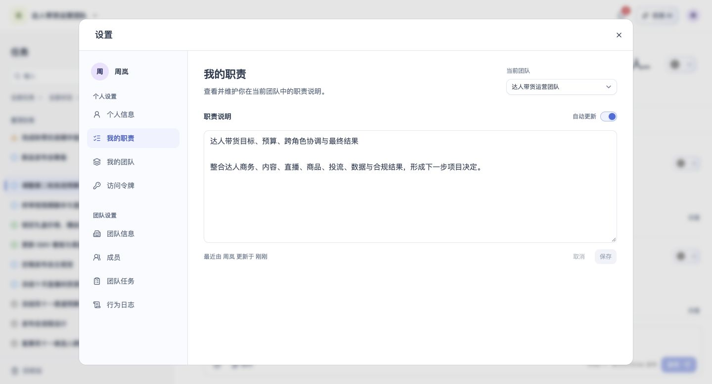

# 我的职责

## 1. 目的

按当前团队维护职责说明。

## 2. 范围和边界

从账户菜单进入设置，在对应页面处理我的职责；操作权限沿用账号及当前团队权限。

## 3. 详细功能设计

我的职责按团队保存，作为任务人员推荐依据；切换当前团队后查看对应内容。

- 用户可查看、编辑和保存职责说明，未填写不阻断进入工作区。
- 自动更新按本人当前团队配置：开启时自动应用有效的 AI 职责建议；关闭时需用户确认后写入，也可忽略。配置未知时仅保留建议。
- 编辑期间暂停自动应用，保存或取消后核对最新版本；旧建议、冲突或保存失败不能覆盖当前内容。
- 保存失败保留输入并允许重试；取消保持已保存内容。

### AI 职责分析

系统**每天检查一次**当前用户在当前团队负责或参与、且有权查看的任务及对应讨论、文件和实际贡献记录。首次建立历史基线，后续合并新增或变化的证据分析；无实质变化时复用结果，不重复生成或提醒。已完成任务可作为历史依据，待开始任务只说明分工，临时协助不直接归纳为长期职责。

用户可主动重新分析。用户修改职责或纠正建议后，立即更新分析依据，使依赖旧版本的建议失效；来源撤销或权限变化后停用相关依据。建议发生实质变化才提醒，正式职责按自动更新配置应用；只有保存成功的内容才用于人员匹配。

职责正文**一条表达一个明确范围，尽量一句话**，说明负责的工作对象与交付结果，例如“负责新品短视频脚本策划与交付”。历史任务、判断依据与待核对事项独立展示，不堆入职责正文，不评价能力、效率或绩效。

*FIG-RESP-001 · 我的职责：查看当前团队职责说明。*

## 4. 功能验收标准

- 页面按本人身份展示可访问的数据与操作，无权限时不能执行写入。
- 页面结果与上述规则一致；失败不得显示成功，保留可重试的信息。

- 无新证据的每日检查不重复分析；多项变化合并处理，主动重新分析可立即执行。
- 不引用其他团队或无权读取的贡献；职责编辑与纠正后旧建议不能覆盖新版本。
- 建议正文精简且与依据分开，临时协助不扩大为长期职责。

- 同一有效建议在自动更新开启时可自动应用，关闭时保持待确认；编辑中、版本冲突或保存失败时不覆盖当前正文。
